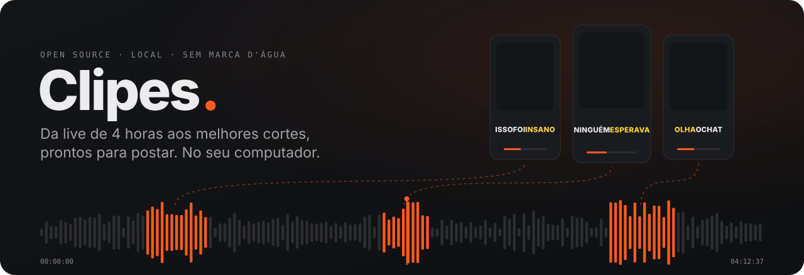
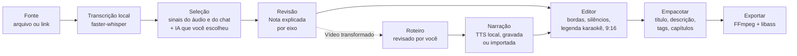
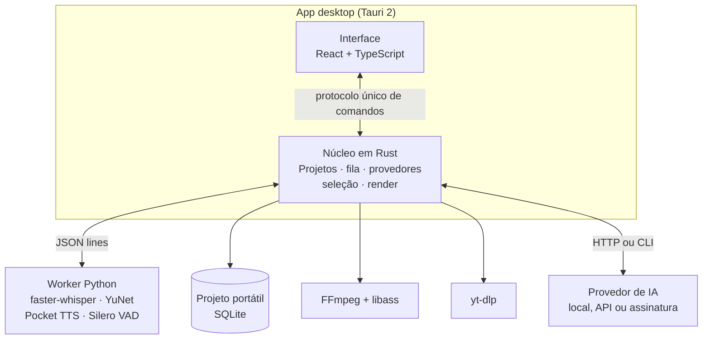

<div align="center">



<br>

**Transforme lives e vídeos longos em cortes verticais prontos para postar.**<br>
Transcrição local, IA que você escolhe, legenda karaokê e 9:16. Sem nuvem obrigatória, sem marca d'água, sem telemetria.

<br>

[](https://github.com/GUSTAVOHOOO/clipes/releases/latest)
[](https://github.com/GUSTAVOHOOO/clipes/actions/workflows/ci.yml)
[](LICENSE)
[](#instalação)
[](CONTRIBUTING.md)

[**Baixar**](https://github.com/GUSTAVOHOOO/clipes/releases/latest) ·
[Como funciona](#como-funciona) ·
[Recursos](#recursos) ·
[Arquitetura](#arquitetura) ·
[Contribuir](#contribuir) ·
[Roadmap](#roadmap) ·
[English](#in-english)

</div>

---

## O que é

O Clipes é um aplicativo de desktop gratuito e open source para quem vive de cortes. Você entrega uma live de quatro horas. Ele transcreve o áudio na sua máquina, aponta os momentos que valem um corte e explica por que cada um ganhou aquela nota. Depois ajusta as bordas para não cortar ninguém no meio da frase, gera a legenda palavra por palavra, enquadra em 9:16 e exporta.

Você revisa tudo antes de sair. Nenhuma etapa é caixa-preta, e nenhuma chamada paga acontece sem você ver o custo estimado antes.

> **v1.0.0 lançada.** Instaladores para Windows e Linux na [página de releases](https://github.com/GUSTAVOHOOO/clipes/releases/latest). A v2, com a interface refeita do zero sobre o mesmo núcleo, está em construção na issue [#288](https://github.com/GUSTAVOHOOO/clipes/issues/288).

## Por que o Clipes existe

As ferramentas de corte na nuvem resolvem o problema cobrando por minuto de vídeo, pedindo o upload da live inteira, dando uma nota que ninguém sabe de onde veio e carimbando marca d'água no plano grátis. Numa live longa, o custo e a espera crescem rápido, e quem tem um computador comum fica sem saída.

O Clipes parte de outras premissas:

| | Ferramentas típicas na nuvem | Clipes |
|---|---|---|
| **Onde o vídeo fica** | Sobe inteiro para o servidor | Fica no seu PC. Só o texto da transcrição vai para a IA, e só se você usar uma IA remota |
| **Quem faz a IA** | O modelo do serviço | O provedor que você escolher, inclusive um modelo local |
| **Custo** | Assinatura ou créditos por minuto | Grátis com modelo local. Com API paga, estimativa antes, valor real depois e teto por tarefa e por lote |
| **Nota do corte** | Um número sem explicação | Nota por eixos nomeados, com o motivo escrito |
| **Marca d'água** | Comum no plano grátis | Nunca |
| **Telemetria** | Normalmente ligada | Não existe. Relatos de problema só saem se você revisar e enviar |
| **Código** | Fechado | Apache-2.0 |

## Como funciona



1. **Crie um Projeto** (um por canal) e importe uma **Fonte**: um arquivo do disco ou o link de um VOD. O Projeto é uma pasta portátil com um banco SQLite, e você pode levá-la para outro computador.
2. **Transcreva no seu PC.** O app detecta GPU NVIDIA ou CPU e escolhe o modelo. Numa RTX 3050, a transcrição ficou mais rápida que o tempo real. Se preferir, o Groq transcreve remotamente: só o áudio sai da máquina, com estimativa de custo e confirmação.
3. **Deixe a IA apontar os momentos.** A live é dividida em Janelas do tamanho certo para o contexto do modelo. Energia do áudio e replay do chat do YouTube entram como sinais. Cada candidato volta com uma Nota explicada.
4. **Revise e edite.** Preview, timeline, transcrição clicável, bordas que encaixam em Frase, remoção de silêncios, legenda karaokê com estilo próprio e reenquadramento 9:16 com sugestão automática, cinco Layouts e crop manual.
5. **Empacote e exporte**, um Corte por vez ou em lote: título, descrição com crédito da Fonte, tags, ideia de capa e capítulos, em PT-BR ou EN.

### Dois tipos de vídeo

| | **Corte direto** | **Vídeo transformado** |
|---|---|---|
| **Para quem** | Canais de cortes | Canais dark |
| **O que é** | O melhor momento da live, recortado e legendado | Um Corte com Roteiro próprio e Narração por cima |
| **Automação** | Rápido e quase automático | Nunca 100% automático: o Roteiro passa por você, para não virar conteúdo em massa |

## Recursos

<table>
<tr>
<td width="50%" valign="top">

**Transcrição**
- `faster-whisper` local, com GPU NVIDIA ou CPU detectada sozinha
- Blocos com checkpoint: fechar o app não perde o trabalho
- Frases navegáveis, busca, correção manual e desfazer
- Motor remoto opcional (Groq), que envia só o áudio
- Medida num conjunto de VODs reais em português e inglês

</td>
<td width="50%" valign="top">

**Seleção de Cortes**
- Janelas planejadas para o contexto de cada modelo
- Sinais de energia do áudio e replay do chat do YouTube
- Nota por eixos nomeados, com o motivo
- Revisão de candidatos e "refazer com o forte" sem perder as revisões anteriores
- Processamento em lote de Fontes, com teto de custo

</td>
</tr>
<tr>
<td valign="top">

**Editor**
- Preview por proxy, timeline e alças de borda com encaixe em Frase
- Remoção de silêncios
- Legenda karaokê com texto e estilo editáveis por Corte
- Reenquadramento 9:16: análise de rosto local (YuNet), cinco Layouts e keyframes de crop

</td>
<td valign="top">

**Exportação**
- FFmpeg + libass, com paridade entre o preview e o arquivo final
- Encoder detectado: NVENC, QSV, AMF, VideoToolbox ou x264
- Loudness normalizado em duas passagens
- Exportação em lote com progresso

</td>
</tr>
<tr>
<td valign="top">

**Vídeo transformado**
- Escolha de ângulo e Roteiro em blocos, travado antes da Narração
- Narração por TTS local (Pocket TTS), gravação com teleprompter ou áudio importado
- Limpeza de voz, alinhamento por palavra e ducking automático da Fonte
- Trilha sonora e efeitos

</td>
<td valign="top">

**Empacotamento e cuidado com o canal**
- Título, descrição com crédito da Fonte, tags, hashtags e ideia de capa
- Capítulos do YouTube gerados a partir do Roteiro
- Tradução de legenda PT-BR ↔ EN
- Perfil de canal e avisos de monetização e de Permissão antes de exportar

</td>
</tr>
</table>

## Sua IA, suas regras

O Clipes não depende de nenhum provedor. Cada Tarefa de IA (seleção, roteiro, empacotamento, tradução) aponta para um Perfil de Provedor que você configura, e cada uma pode usar um diferente.

| Tipo | Exemplos | Quanto custa | O que sai da máquina |
|---|---|---|---|
| **Modelo local** | Ollama, LM Studio ou outro servidor compatível com OpenAI | Nada | Nada |
| **API** | OpenAI, Anthropic, Gemini ou qualquer endpoint compatível com OpenAI | Por token. Estimativa antes, valor real depois | Só o texto das Frases |
| **CLI com a sua assinatura** *(experimental)* | Codex, Claude Code, OpenCode | Já incluído no plano que você paga | Só o texto das Frases |

Você também ganha:

- **Somente local**, por Tarefa ou pelo Projeto inteiro. Com ele ligado, nenhuma chamada remota é feita, nem para "refazer com o forte".
- **Orçamento** por chamada, por tarefa e por lote. O app para quando chega no teto.
- **Trilha de auditoria** de cada chamada: modelo, tokens, custo e versão do prompt.
- **Nada de repetição às cegas.** Uma chamada paga com resultado incerto nunca é refeita sozinha.
- **Chaves no cofre do sistema** (Windows Credential Manager ou Secret Service no Linux), nunca em texto puro no Projeto.

## Instalação

| Sistema | Pacote | Observação |
|---|---|---|
| **Windows 10 e 11** (x64) | Instalador `.exe` (NSIS) | Instala para o usuário atual, sem pedir administrador |
| **Linux** (x64) | `.AppImage` ou `.deb` | O `.deb` já declara as dependências de mídia |
| **macOS** | Ainda não | Acompanhe em [#301](https://github.com/GUSTAVOHOOO/clipes/issues/301) |

**[Baixar a última versão →](https://github.com/GUSTAVOHOOO/clipes/releases/latest)**

Os instaladores são enxutos de propósito. FFmpeg, yt-dlp, o worker Python e os modelos são baixados na primeira vez, pela tela de **Componentes**, onde você vê o tamanho e a licença de cada um antes de confirmar. Cada download é conferido por SHA-256. O modelo de transcrição tem cerca de 0,5 GB na CPU e 1,6 GB na GPU.

O app se atualiza sozinho com pacotes assinados.

<details>
<summary><b>Windows: aviso do SmartScreen</b></summary>

<br>

O instalador ainda não tem assinatura de código. A assinatura gratuita para projetos open source pela SignPath Foundation está planejada em [#24](https://github.com/GUSTAVOHOOO/clipes/issues/24). Até lá, o SmartScreen pode dizer que o aplicativo é desconhecido.

Antes de executar, confira o arquivo com o `SHA256SUMS.txt` publicado na mesma release:

```powershell
Get-FileHash .\Clipes_1.0.0_x64-setup.exe -Algorithm SHA256
```

Se o hash bater, clique em **Mais informações** e depois em **Executar assim mesmo**.

</details>

<details>
<summary><b>Linux: AppImage e GStreamer</b></summary>

<br>

O preview usa o GStreamer do sistema. O `.deb` já instala o que precisa. O AppImage não embute GStreamer nem `libav` (veja o [ADR-0003](docs/adr/0003-licenca-apache-ffmpeg-sob-demanda-e-politica-de-modelos.md)), então, no Debian ou Ubuntu, instale:

```sh
sudo apt install gstreamer1.0-plugins-good gstreamer1.0-plugins-bad gstreamer1.0-libav
```

</details>

## Arquitetura



- **Núcleo em Rust**: toda a regra de negócio mora aqui. A interface só chama comandos. Por isso a v2 pode refazer a interface inteira sem tocar no que o app faz.
- **Fila persistida**: transcrição, seleção e exportação são jobs no SQLite. O app fecha, abre de novo e continua de onde parou.
- **Worker Python isolado**: os modelos de ML rodam num processo separado, num ambiente do `uv` que o app instala sozinho. Ele não usa o Python do sistema.
- **Tarefas de IA como workflows fixos**: cada Tarefa tem prompt versionado e travado por hash, saída estruturada validada por schema e verificadores próprios. Trocar de provedor não muda o resultado esperado.

| Camada | Tecnologia |
|---|---|
| Desktop | [Tauri 2](https://tauri.app/), que usa o WebView do sistema e gera instaladores pequenos |
| Interface | React 19, TypeScript, Vite, Bun, Base UI, Tailwind 4 e cores em OKLCH |
| Núcleo | Rust e SQLite (rusqlite), com chaves no cofre do sistema (keyring) |
| ML | Python via `uv`: faster-whisper, YuNet, Silero VAD e Pocket TTS |
| Mídia | FFmpeg e libass, baixados sob demanda |
| Qualidade | GitHub Actions em Ubuntu e Windows, `cargo-deny` (licenças e vulnerabilidades), E2E com tauri-driver e WebdriverIO, DCO |

Cada decisão importante tem um registro com o contexto e o motivo:

| ADR | Decisão |
|---|---|
| [0001](docs/adr/0001-dois-tipos-de-video-e-regras-de-transformacao.md) | Dois tipos de vídeo e as regras do Vídeo transformado |
| [0002](docs/adr/0002-hyperframes-como-referencia-render-ffmpeg-libass.md) | Render com FFmpeg e libass |
| [0003](docs/adr/0003-licenca-apache-ffmpeg-sob-demanda-e-politica-de-modelos.md) | Apache-2.0, FFmpeg sob demanda e política de modelos |
| [0004](docs/adr/0004-stack-tauri-react-nucleo-rust-worker-python.md) | Tauri + React, núcleo Rust e worker Python |
| [0005](docs/adr/0005-projeto-portatil-com-sqlite.md) | Projeto portátil com SQLite |
| [0006](docs/adr/0006-relato-de-problemas-sem-telemetria.md) | Relato de problemas sem telemetria |
| [0007](docs/adr/0007-tarefas-de-ia-como-workflows-fixos-no-nucleo.md) | Tarefas de IA como workflows fixos no núcleo |
| [0008](docs/adr/0008-contrato-de-saida-estruturada-agnostico-de-provedor.md) | Saída estruturada independente de provedor |
| [0009](docs/adr/0009-custo-orcamento-e-auditoria-de-chamadas-de-ia.md) | Custo, orçamento e auditoria das chamadas de IA |
| [0010](docs/adr/0010-perfis-multiplos-de-provedor-tarefa-para-perfil-e-somente-local.md) | Vários Perfis de Provedor e "Somente local" |

<details>
<summary><b>Mapa do repositório</b></summary>

<br>

| Pasta | Conteúdo |
|---|---|
| [`core/`](core/) | Núcleo em Rust: comandos, Projetos, fila, provedores, seleção, render |
| [`src/`](src/) | Interface React da v1 |
| [`src-tauri/`](src-tauri/) | Casca Tauri: janela, updater e empacotamento |
| [`worker/`](worker/) | Worker Python de ML |
| [`catalog/`](catalog/) | Catálogo assinado de modelos |
| [`benchmarks/`](benchmarks/) | Dataset de VODs e benchmarks de transcrição e seleção |
| [`design-system/`](design-system/) | Demo do design system da v1, que roda no navegador |
| [`docs/adr/`](docs/adr/) | Registros de decisão |
| [`docs/research/`](docs/research/) | Pesquisas e experimentos, com os números |
| [`docs/produto/`](docs/produto/) | Catálogo de funcionalidades do núcleo e a especificação da v2 |
| [`docs/contribuindo/`](docs/contribuindo/) | Guias técnicos por área |

</details>

## Feito com medição

As decisões de modelo e de pipeline vêm de benchmarks reproduzíveis, não de palpite. Os relatórios ficam em [`docs/research/`](docs/research/) e o código em [`benchmarks/`](benchmarks/) e em `core/src/selection/`.

- **Transcrição**: modelos e precisões comparados em VODs reais em PT-BR e EN, inclusive bordas de palavra medidas contra alinhamento forçado (MFA).
- **Seleção de Cortes**: um harness compara a seleção com cortes feitos por humanos em lives reais. Ele já decidiu o tamanho das Janelas (15 min com 3 min de sobreposição), descartou cascatas de modelo que não compensavam e mostrou que sinais sem IA (áudio, chat e texto) encontram uma parte relevante dos bons momentos. Isso abre caminho para uma seleção mais barata na v2.

## Roadmap

- [x] **v1.0**: núcleo completo, Corte direto e Vídeo transformado, instaladores para Windows e Linux
- [ ] **v2**: interface refeita do zero, minimalista e mais rápida de operar, sobre o mesmo núcleo ([#288](https://github.com/GUSTAVOHOOO/clipes/issues/288)). Pesquisa de UX, arquitetura de informação, wireframes e direção visual já estão em [`docs/produto/front-v2/`](docs/produto/front-v2/)
- [ ] Seleção de Cortes guiada por sinais, com a IA só refinando os candidatos
- [ ] macOS ([#301](https://github.com/GUSTAVOHOOO/clipes/issues/301)) e assinatura de código no Windows ([#24](https://github.com/GUSTAVOHOOO/clipes/issues/24))
- [ ] Mais adiante: servidor MCP para agentes ([#192](https://github.com/GUSTAVOHOOO/clipes/issues/192)), clonagem de voz ([#214](https://github.com/GUSTAVOHOOO/clipes/issues/214)) e o resto de [melhorias futuras](docs/futuro.md)

## Contribuir

Contribuições são bem-vindas, de correção de texto a provedor novo.

```sh
git clone https://github.com/GUSTAVOHOOO/clipes.git
cd clipes
bun install
bun run tauri dev
```

Você precisa de Rust estável, [Bun](https://bun.sh/) e dos [pré-requisitos do Tauri](https://v2.tauri.app/start/prerequisites/) para o seu sistema.

| Comando | O que faz |
|---|---|
| `bun run tauri dev` | Abre o app em modo de desenvolvimento |
| `VITE_CORE_MOCK=1 bun run dev` | Só a interface no navegador, com o núcleo simulado |
| `cargo test -p clipes-core` | Testes do núcleo |
| `bun run typecheck` · `bun run test:ui` | Tipos e testes da interface |
| `bun run test:e2e` | Testes de ponta a ponta no app real ([guia](docs/contribuindo/testes-e2e.md)) |

Antes do primeiro PR:

1. Leia o [guia de contribuição](CONTRIBUTING.md). Todo commit leva `Signed-off-by` (`git commit -s`, [DCO](https://developercertificate.org/)).
2. Use o vocabulário do [glossário](GLOSSARY.md). Fonte, Corte, Janela e Nota têm significado preciso aqui.
3. Para estender o app, há guias de [Provedor](docs/contribuindo/provedor.md), [Motor de transcrição](docs/contribuindo/motor-de-transcricao.md), [Tarefa de IA](docs/contribuindo/tarefa-de-ia.md) e [OpenCode](docs/contribuindo/opencode.md).
4. Discorda de um ADR? Ótimo. Abra uma issue com a evidência. Os ADRs valem até um fato novo mostrar o contrário.

## Comunidade e suporte

- **Bug ou ideia:** [abra uma issue](https://github.com/GUSTAVOHOOO/clipes/issues/new/choose)
- **Dúvida de uso:** [Discussions](https://github.com/GUSTAVOHOOO/clipes/discussions)
- **Vulnerabilidade:** siga o [SECURITY.md](SECURITY.md). Não abra issue pública
- **Problema no app:** use **Relatos**, dentro do próprio Clipes. Ele monta um diagnóstico filtrado que você revisa antes de enviar

## Perguntas frequentes

<details>
<summary><b>Preciso de placa de vídeo?</b></summary>

<br>

Não. Sem GPU NVIDIA, o Clipes transcreve na CPU com um modelo menor, e por padrão agrupa os trechos de fala para ganhar velocidade. Com GPU NVIDIA, usa um modelo maior e mais preciso.

</details>

<details>
<summary><b>Dá para usar sem pagar nenhuma IA?</b></summary>

<br>

Sim. Aponte as Tarefas para um modelo local (Ollama ou LM Studio) e ligue **Somente local** no Projeto. Nada sai da máquina e nada é cobrado. Se você já paga uma assinatura com CLI (Codex, Claude Code ou OpenCode), também pode usá-la, ainda em caráter experimental.

</details>

<details>
<summary><b>O que exatamente vai para a IA?</b></summary>

<br>

Só o texto das Frases da transcrição, num formato compacto, nunca o vídeo nem o áudio. A única exceção é o motor de transcrição remoto (Groq), que envia o áudio, e só se você escolher esse motor e confirmar o custo.

</details>

<details>
<summary><b>Posso cortar a live de qualquer pessoa?</b></summary>

<br>

O Clipes registra a Permissão de cada Fonte: quem autorizou, onde e para quê. O crédito ao criador entra na descrição automaticamente, e o app avisa antes de exportar um Corte sem Permissão. A responsabilidade pelo uso continua sendo de quem publica.

</details>

<details>
<summary><b>Meu Projeto fica preso ao app?</b></summary>

<br>

Não. Um Projeto é uma pasta com um banco SQLite e as mídias. Copie a pasta para outro computador e abra. O app faz backup automático rotativo e restaura com verificação.

</details>

## Para mantenedores

<details>
<summary><b>Publicar uma release</b></summary>

<br>

1. Suba a versão em `package.json`, `src-tauri/tauri.conf.json`, `src-tauri/Cargo.toml` e `core/Cargo.toml`, e atualize o [CHANGELOG](CHANGELOG.md).
2. Crie a tag no commit a publicar, por exemplo `git tag v1.0.0` e `git push origin v1.0.0`.
3. O fluxo **Instaladores e release** gera o `.exe`, o `.AppImage` e o `.deb`, assina os pacotes do updater, publica o `SHA256SUMS.txt` e o `latest.json`.

Tags `catalog-N` publicam o catálogo de modelos assinado (Ed25519) por outro fluxo. A configuração das chaves do updater está no [guia de contribuição](CONTRIBUTING.md#chave-do-updater).

</details>

## Licença e créditos

O Clipes é distribuído sob a [Apache-2.0](LICENSE). Dependências e modelos seguem a política do [ADR-0003](docs/adr/0003-licenca-apache-ffmpeg-sob-demanda-e-politica-de-modelos.md), e os avisos de terceiros estão em [`THIRD_PARTY_NOTICES.md`](THIRD_PARTY_NOTICES.md).

Este projeto se apoia em trabalho aberto de muita gente: [Tauri](https://tauri.app/), [faster-whisper](https://github.com/SYSTRAN/faster-whisper), [FFmpeg](https://ffmpeg.org/), [libass](https://github.com/libass/libass), [yt-dlp](https://github.com/yt-dlp/yt-dlp), [Silero VAD](https://github.com/snakers4/silero-vad), [YuNet](https://github.com/opencv/opencv_zoo) e [Pocket TTS](https://github.com/kyutai-labs/pocket-tts).

---

## In English

**Clipes** is a free, open source desktop app that turns long livestreams and videos into vertical, captioned short clips. It runs on your own machine.

- **Local first.** Transcription runs on your PC with faster-whisper, on an NVIDIA GPU or on the CPU. Your video never leaves the machine.
- **Bring your own AI.** Use a local model (Ollama, LM Studio), an API (OpenAI, Anthropic, Gemini, any OpenAI-compatible endpoint), or a CLI subscription you already pay for (Codex, Claude Code, OpenCode). A "local only" switch blocks remote calls per task or per project.
- **No surprises.** The app shows the estimated cost before each paid call and the real cost after, stops at your budget, and keeps an audit trail.
- **Explainable picks.** Every suggested clip comes with a score broken down by named criteria and a written reason.
- **Full editor.** Proxy preview, timeline, phrase-snapping trims, silence removal, karaoke captions, 9:16 reframing with face detection, FFmpeg + libass export with hardware encoders. No watermark, no telemetry.

Installers for Windows and Linux are on the [releases page](https://github.com/GUSTAVOHOOO/clipes/releases/latest). The project is written and documented in Brazilian Portuguese. Issues and PRs in English are welcome.

<div align="center">
<br>
<sub>Feito no Brasil, com código aberto, para quem corta live de madrugada.</sub>
</div>
