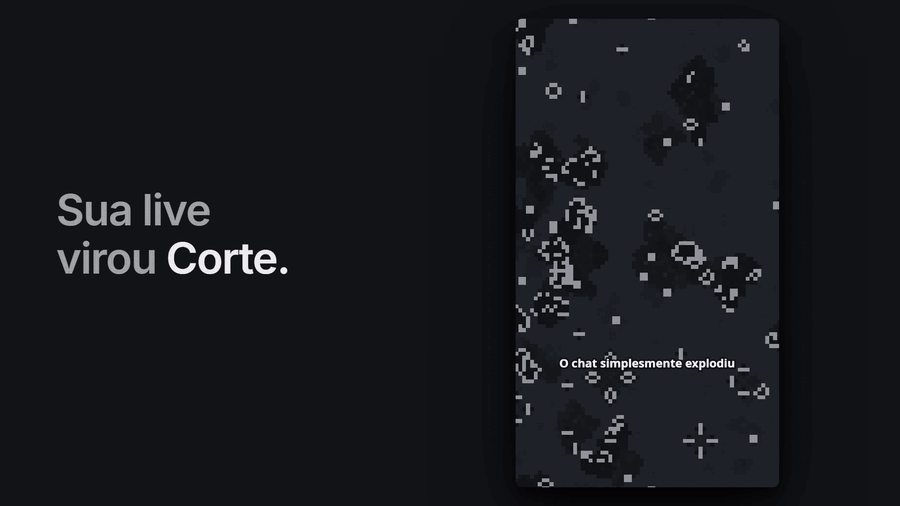
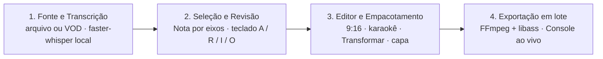
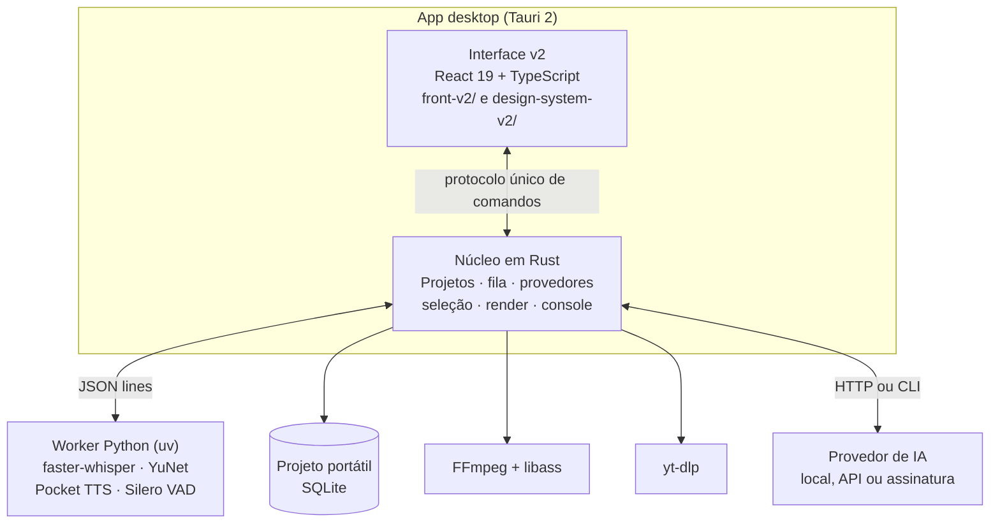

<div align="center">


<br>

**Transforme lives gravadas e vídeos longos em Cortes verticais prontos para postar.**<br>
Transcrição local, Provedor de IA à sua escolha, legenda karaokê e Reenquadramento 9:16 — feito para **Canais de cortes** e **Canais dark**. Sem nuvem obrigatória, sem marca d'água, sem telemetria.

<br>

[](https://github.com/GUSTAVOHOOO/clipes/releases/latest)

<br>

[](https://github.com/GUSTAVOHOOO/clipes/releases/latest)
[](https://github.com/GUSTAVOHOOO/clipes/actions/workflows/ci.yml)
[](LICENSE)
[](#instalação-e-requisitos)
[](CONTRIBUTING.md)

<br>

[Como funciona](#como-funciona) ·
[Por que Clipes](#por-que-clipes) ·
[Local e Provedores](#processamento-local-e-provedores) ·
[Instalação](#instalação-e-requisitos) ·
[Guia completo](docs/guia-de-uso.md) ·
[Arquitetura](#arquitetura) ·
[Contribuir](#contribuir-e-apoiar) ·
[English](#in-english)

<br>

<a href="https://github.com/GUSTAVOHOOO/clipes/releases/download/v2.0.0/Clipes-v2-lancamento-16x9.mp4">
  
</a>

<sub>Clique na prévia para assistir ao vídeo completo em 16:9 (1080p, 30 s) · <a href="https://github.com/GUSTAVOHOOO/clipes/releases/download/v2.0.0/Clipes-v2-lancamento-9x16.mp4">Assista na versão vertical (9:16)</a></sub>

</div>

---

## Por que Clipes

Você entrega um arquivo local ou um **VOD** de horas. O Clipes transcreve o áudio no seu computador, aponta os trechos com mais potencial explicando a **Nota** de cada um, encaixa as bordas em **Frase** para não cortar ninguém no meio da fala e exporta arquivos MP4 1080×1920 com legenda karaokê e áudio a -14 LUFS.

Nenhuma etapa é caixa-preta: você revisa antes de exportar, vê a estimativa de custo antes de qualquer chamada paga e acompanha o processamento em tempo real.

| | Ferramentas típicas na nuvem | Clipes |
|---|---|---|
| **Onde o vídeo fica** | Sobe inteiro para o servidor | Fica no seu PC. Só o texto das Frases vai para a IA, e só se você escolher um Provedor remoto |
| **Quem faz a IA** | O modelo fixo do serviço | O **Provedor** que você escolher — modelo local, API ou assinatura via CLI |
| **Custo** | Assinatura mensal ou créditos por minuto | Grátis com modelo local. Com API paga: estimativa antes, valor real depois e teto por tarefa e por lote |
| **Nota do Corte** | Um número sem explicação | **Nota** por eixos nomeados, com o motivo escrito para cada eixo |
| **O que roda por baixo** | Barra de progresso genérica | **Console ao vivo** *(v2.0.1)* mostrando FFmpeg, transcrição, instalação e Tarefas de IA em tempo real, com chaves e caminhos ocultados |
| **Marca d'água** | Comum no plano grátis | Nunca |
| **Telemetria** | Normalmente ligada | Não existe. Relatos só saem se você revisar e enviar |
| **Código e dados** | Fechado e preso à nuvem | [Apache-2.0](LICENSE) e **Projeto** portátil em pasta `.clipes` com SQLite |

> **A v2 troca a interface, não o núcleo.** As telas foram refeitas do zero sobre o mesmo núcleo em Rust, o mesmo formato de Projeto e os mesmos Provedores da [v1.0.0](docs/releases/v1.0.0.md) (veja as [notas da v2.0.0](docs/releases/v2.0.0.md)). **Projetos criados na v1 abrem direto na v2** em **Início → Abrir pasta `.clipes`**.

## Como funciona



1. **Importe a Fonte e transcreva localmente.** Traga um arquivo do disco ou cole a URL de um VOD (`yt-dlp` baixado sob demanda) registrando a **Permissão** do criador. O **Motor de transcrição** padrão roda `faster-whisper` na sua GPU NVIDIA ou CPU a US$ 0,00, com checkpoint por blocos — ou via Groq remoto, se você optar e confirmar o custo.
2. **Selecione e revise sem tirar a mão do teclado.** Escolha **Corte direto** ou **Vídeo transformado**, combine sinais locais (energia do áudio e replay do chat do YouTube) com o **Perfil de Provedor** desejado e aprove ou ajuste candidatos na **Bancada de Revisão** (`A`/`R`, `I`/`O`, `Ctrl+Z`, `Enter`) vendo o preview 9:16 e a **Nota** explicada por eixos.
3. **Edite, transforme e empacote.** Ajuste bordas encaixadas em **Frase** (`Alt` libera quadro a quadro), aplique **Reenquadramento** 9:16 com detecção de rosto (YuNet) em cinco **Layouts**, legenda karaokê (com tradução PT-BR ↔ EN), remoção de silêncios e áudio. Em **Vídeo transformado**, a aba **Transformar** exige sua aprovação do **Roteiro** antes da **Narração** (Pocket TTS local, teleprompter ou áudio importado). Em **Empacotar**, feche capa PNG, título, descrição com crédito protegido da Fonte e tags.
4. **Exporte em lote com visibilidade total.** Renderize um Corte (`Ctrl+E`) ou todos os aprovados pela **Mesa de Prontidão** com FFmpeg + libass, normalização a -14 LUFS e encoder de hardware (NVENC, QSV, AMF ou x264). Acompanhe tudo na **Fila de Jobs** (`Ctrl+J`) e no **Console ao vivo** *(novidade da v2.0.1)* — que exibe FFmpeg, transcrição, instalação de Componentes e Tarefas de IA em tempo real, ocultando chaves e caminhos do sistema automaticamente.

Quer ver cada tela e todos os atalhos em detalhe? Leia o **[Guia de uso completo](docs/guia-de-uso.md)** (vocabulário no [GLOSSARY.md](GLOSSARY.md)).

## Processamento local e Provedores

O Clipes funciona sem conta e sem enviar seu vídeo para fora da máquina. Um **Provedor** só entra nas **Tarefas de IA**, e você decide qual usar em cada tarefa.

| Etapa | Onde roda | O que sai da máquina |
|---|---|---|
| Transcrição (padrão) | Local (`faster-whisper` na GPU ou CPU) | Nada |
| Transcrição remota (Groq, opcional) | Servidor do Groq | Só o áudio, com estimativa e confirmação |
| Energia do áudio, detecção de rosto (YuNet), VAD, Narração (Pocket TTS) | Local | Nada |
| Seleção de Cortes, Roteiro, Empacotamento, tradução de legenda | No Provedor que você escolher | Só o texto das Frases — nunca vídeo nem áudio |
| Revisão, edição e exportação | Local (FFmpeg + libass) | Nada |

| Tipo de Provedor | Exemplos | Custo | O que sai da máquina |
|---|---|---|---|
| **Modelo local** | Ollama, LM Studio ou endpoint compatível com OpenAI em loopback | US$ 0,00 | Nada |
| **Chave de API** | OpenAI, Anthropic, Gemini ou endpoint compatível com OpenAI | Por token (estimativa antes, valor real depois) | Só o texto das Frases |
| **Assinatura via CLI** *(experimental)* | Codex, Claude Code, OpenCode | Incluso no plano que você já paga | Só o texto das Frases |

**Proteções embutidas:**
- **Estimativa antes de gastar:** toda chamada externa mostra Perfil de Provedor, destino, estimativa em dólar ou cota e teto restante antes de rodar.
- **Somente local:** chave por Tarefa ou veto para o Projeto inteiro; ligada, bloqueia qualquer envio externo e sinaliza na barra superior.
- **Orçamento e auditoria:** teto por chamada, tarefa e lote, sem repetição às cegas quando uma chamada paga fica incerta, e histórico de tokens/custo em **Configurações → Custos** sem guardar o texto enviado.
- **Chaves no cofre do sistema:** Windows Credential Manager ou Secret Service no Linux, nunca em texto puro no Projeto, e ocultadas no Console ao vivo.

Detalhes nos registros [ADR-0009](docs/adr/0009-custo-orcamento-e-auditoria-de-chamadas-de-ia.md) e [ADR-0010](docs/adr/0010-perfis-multiplos-de-provedor-tarefa-para-perfil-e-somente-local.md).

## Instalação e requisitos

Baixe o instalador mais recente na **[página de releases](https://github.com/GUSTAVOHOOO/clipes/releases/latest)**. O aplicativo verifica e instala atualizações assinadas automaticamente.

| Sistema | Pacote | Requisitos |
|---|---|---|
| **Windows 10 e 11** (x64) | Instalador `.exe` (NSIS, instala para o usuário atual sem administrador) | WebView2 (já vem no Windows 11). GPU NVIDIA opcional |
| **Linux** (x64) | `.AppImage` ou `.deb` | GStreamer do sistema para o preview (o `.deb` já declara as dependências). GPU NVIDIA opcional |
| **macOS** | Ainda não | Acompanhe em [#301](https://github.com/GUSTAVOHOOO/clipes/issues/301) |

Na primeira abertura, o **Assistente de primeiro uso** instala o FFmpeg e o Motor de transcrição local (~0,5 GB na CPU ou ~1,6 GB na GPU). Recursos opcionais (`yt-dlp`, YuNet, Pocket TTS) são baixados sob demanda em **Configurações → Componentes**, sempre com tamanho, licença e conferência por SHA-256.

<details>
<summary><b>Windows: aviso do SmartScreen</b></summary>

<br>

O instalador `.exe` do Windows ainda não possui certificado de assinatura de código — a assinatura pela SignPath Foundation está planejada em [#24](https://github.com/GUSTAVOHOOO/clipes/issues/24), mas ainda não está configurada no fluxo de release (apenas os pacotes do updater recebem assinatura Ed25519 do Tauri). Por isso, o SmartScreen pode avisar que o aplicativo é desconhecido.

Antes de executar, confira o arquivo com o `SHA256SUMS.txt` publicado na mesma release:

```powershell
Get-FileHash .\Clipes_<versao>_x64-setup.exe -Algorithm SHA256
```

Se o hash bater, clique em **Mais informações** e depois em **Executar assim mesmo**.

</details>

<details>
<summary><b>Linux: AppImage e GStreamer</b></summary>

<br>

O preview usa o GStreamer do sistema. O `.deb` já instala o que precisa; o AppImage não embute GStreamer nem `libav` ([ADR-0003](docs/adr/0003-licenca-apache-ffmpeg-sob-demanda-e-politica-de-modelos.md)). No Debian ou Ubuntu, instale:

```sh
sudo apt install gstreamer1.0-plugins-good gstreamer1.0-plugins-bad gstreamer1.0-libav
```

</details>

<details>
<summary><b>Experimentar a interface no navegador sem instalar</b></summary>

<br>

Dá para abrir a interface v2 no navegador com o núcleo simulado e dados de exemplo (para conhecer as telas, sem processar vídeo de verdade):

```sh
cd front-v2
bun install
bun run dev   # http://127.0.0.1:1430 (sobe com VITE_CORE_MOCK=1)
```

Para carregar o Projeto de demonstração, abra `http://127.0.0.1:1430/?source-test=1#/projeto/test-project/cortes`. Detalhes em [`front-v2/README.md`](front-v2/README.md).

</details>

## Arquitetura



| Camada | Tecnologia |
|---|---|
| Desktop | [Tauri 2](https://tauri.app/) (WebView do sistema, instaladores leves, updater assinado) |
| Interface | React 19, TypeScript, Vite, Bun, Base UI, Tailwind 4 e cores em OKLCH sobre [`design-system-v2/`](design-system-v2/) |
| Núcleo | Rust e SQLite (`rusqlite`), fila persistida, redator de segredos no Console ao vivo e chaves no cofre (`keyring`) |
| ML | Worker Python isolado via `uv`: `faster-whisper`, YuNet, Silero VAD e Pocket TTS |
| Mídia | FFmpeg e libass sob demanda, com paridade entre preview e exportação |
| Qualidade | GitHub Actions (Ubuntu e Windows), `cargo-deny`, Vitest, Playwright, E2E real com `tauri-driver` + WebdriverIO, DCO |

**Feito com medição:** as escolhas de modelo, tamanho de **Janela de seleção** (15 min com 3 min de sobreposição) e sinais locais vêm de benchmarks reproduzíveis em [`benchmarks/`](benchmarks/) com relatórios em [`docs/research/`](docs/research/).

<details>
<summary><b>Decisões de arquitetura (ADRs 0001–0010) e mapa do repositório</b></summary>

<br>

| ADR | Decisão |
|---|---|
| [0001](docs/adr/0001-dois-tipos-de-video-e-regras-de-transformacao.md) | Dois tipos de vídeo e as regras do Vídeo transformado |
| [0002](docs/adr/0002-hyperframes-como-referencia-render-ffmpeg-libass.md) | Render com FFmpeg e libass |
| [0003](docs/adr/0003-licenca-apache-ffmpeg-sob-demanda-e-politica-de-modelos.md) | Apache-2.0, FFmpeg sob demanda e política de modelos |
| [0004](docs/adr/0004-stack-tauri-react-nucleo-rust-worker-python.md) | Tauri + React, núcleo Rust e worker Python |
| [0005](docs/adr/0005-projeto-portatil-com-sqlite.md) | Projeto portátil com SQLite |
| [0006](docs/adr/0006-relato-de-problemas-sem-telemetria.md) | Relato de problemas sem telemetria |
| [0007](docs/adr/0007-tarefas-de-ia-como-workflows-fixos-no-nucleo.md) | Tarefas de IA como workflows fixos no núcleo |
| [0008](docs/adr/0008-contrato-de-saida-estruturada-agnostico-de-provedor.md) | Saída estruturada independente de Provedor |
| [0009](docs/adr/0009-custo-orcamento-e-auditoria-de-chamadas-de-ia.md) | Custo, orçamento e auditoria das chamadas de IA |
| [0010](docs/adr/0010-perfis-multiplos-de-provedor-tarefa-para-perfil-e-somente-local.md) | Vários Perfis de Provedor e "Somente local" |

| Pasta | Conteúdo |
|---|---|
| [`core/`](core/) | Núcleo em Rust: comandos, Projetos, fila, Provedores, seleção, render e console ao vivo |
| [`front-v2/`](front-v2/) | Interface v2 (telas, rotas, Fila de Jobs, Console ao vivo, atalhos) |
| [`design-system-v2/`](design-system-v2/) | Componentes e tokens visuais da v2 |
| [`src/`](src/) e [`design-system/`](design-system/) | Interface da v1 mantida como caminho de reversão e módulos compartilhados |
| [`src-tauri/`](src-tauri/) | Casca Tauri: janela, updater e empacotamento |
| [`worker/`](worker/) | Worker Python de ML |
| [`catalog/`](catalog/) | Catálogo assinado de modelos |
| [`benchmarks/`](benchmarks/) | Dataset de VODs e benchmarks de transcrição e seleção |
| [`docs/adr/`](docs/adr/), [`docs/research/`](docs/research/), [`docs/produto/`](docs/produto/), [`docs/contribuindo/`](docs/contribuindo/) | ADRs, pesquisas com números, especificação da v2 e guias técnicos |

</details>

### Roadmap

- [x] **v1.0**: núcleo completo, Corte direto e Vídeo transformado, instaladores para Windows e Linux
- [x] **v2.0**: interface refeita do zero sobre o mesmo núcleo ([#288](https://github.com/GUSTAVOHOOO/clipes/issues/288))
- [x] **Console ao vivo** *(sai na v2.0.1)*: acompanhamento em tempo real de FFmpeg, transcrição, instalação e Tarefas de IA com redação de segredos
- [ ] Seleção de Cortes guiada por sinais locais, com o Provedor refinando candidatos ([#319](https://github.com/GUSTAVOHOOO/clipes/issues/319))
- [ ] macOS ([#301](https://github.com/GUSTAVOHOOO/clipes/issues/301))
- [ ] Servidor MCP para agentes ([#192](https://github.com/GUSTAVOHOOO/clipes/issues/192)), clonagem de voz ([#214](https://github.com/GUSTAVOHOOO/clipes/issues/214)) e demais itens em [melhorias futuras](docs/futuro.md)

## Ajuda e perguntas frequentes

- **Dúvidas de uso:** [Discussions](https://github.com/GUSTAVOHOOO/clipes/discussions) e [Guia de uso](docs/guia-de-uso.md).
- **Bugs ou ideias:** [abra uma issue](https://github.com/GUSTAVOHOOO/clipes/issues/new/choose) ou use **Relatos** dentro do app, que monta um diagnóstico filtrado para você revisar antes de enviar.
- **Vulnerabilidades:** siga o [SECURITY.md](SECURITY.md) (não abra issue pública).

<details>
<summary><b>Limitações conhecidas</b></summary>

<br>

- **Windows sem assinatura de código:** o instalador NSIS ainda não tem certificado Authenticode (apenas os pacotes do updater são assinados); confira o hash em `SHA256SUMS.txt`.
- **macOS** ainda sem instalador ([#301](https://github.com/GUSTAVOHOOO/clipes/issues/301)).
- **Linux AppImage** depende do GStreamer do sistema para o preview.
- **Provedores via CLI** (Codex, Claude Code, OpenCode) seguem experimentais.
- **YouTube com restrição de idade:** o app detecta e orienta a baixar o vídeo e importar como arquivo local.
- **Idioma da interface v2:** atualmente em PT-BR (`English` aparece como *Em preparação* em **Configurações → Aparência e teclado**). A Transcrição fica no idioma original da Fonte; a legenda e a tradução de Cortes suportam PT-BR ↔ EN.

</details>

<details>
<summary><b>Preciso de placa de vídeo?</b></summary>

<br>

Não. Sem GPU NVIDIA, o Clipes transcreve na CPU com um modelo menor e agrupa trechos de fala (VAD) por padrão para ganhar velocidade. Com GPU NVIDIA, usa um modelo maior e mais preciso.

</details>

<details>
<summary><b>Meus Projetos da v1 funcionam na v2?</b></summary>

<br>

Sim. A v2 troca apenas a interface; o núcleo e o formato `.clipes` (SQLite) são os mesmos. Abra em **Início → Abrir pasta `.clipes`**. O app também mantém backup automático rotativo.

</details>

<details>
<summary><b>Dá para usar sem pagar nenhuma IA?</b></summary>

<br>

Sim. Aponte as Tarefas de IA para um modelo local (Ollama ou LM Studio) e ligue **Somente local** no Projeto. Nada sai da máquina e nada é cobrado. Também é possível usar uma assinatura via CLI já existente (Codex, Claude Code ou OpenCode, em caráter experimental).

</details>

<details>
<summary><b>O que exatamente vai para a IA?</b></summary>

<br>

Apenas o texto das Frases da Transcrição em formato compacto — nunca o vídeo nem o áudio. A única exceção é o Motor de transcrição remoto (Groq), que envia o áudio somente se você escolher esse motor e confirmar o custo.

</details>

<details>
<summary><b>Posso cortar a live de qualquer pessoa?</b></summary>

<br>

O Clipes registra a **Permissão** de cada Fonte (quem autorizou, onde e para quê), inclui o crédito na descrição automaticamente e avisa antes de exportar um Corte sem Permissão registrada. A responsabilidade pelo uso continua sendo de quem publica.

</details>

<details>
<summary><b>Meu Projeto fica preso ao app?</b></summary>

<br>

Não. Um Projeto é uma pasta `.clipes` com um banco SQLite e os arquivos gerados. Copie a pasta para outro computador e abra. O app faz backup automático rotativo e restaura com verificação.

</details>

## Contribuir e apoiar

Se o Clipes ajudou no seu fluxo de cortes ou você acompanha o desenvolvimento, deixar uma estrela no repositório ajuda outras pessoas a encontrarem o projeto.

Contribuições são bem-vindas — de correção de texto a um novo Provedor:

```sh
git clone https://github.com/GUSTAVOHOOO/clipes.git
cd clipes
bun install
bun install --cwd design-system-v2
bun install --cwd front-v2
bun run tauri dev
```

Requisitos para desenvolver: Rust estável, [Bun](https://bun.sh/) e os [pré-requisitos do Tauri](https://v2.tauri.app/start/prerequisites/).

| Comando | O que faz |
|---|---|
| `bun run tauri dev` | Abre o app desktop em modo de desenvolvimento (`front-v2/`) |
| `cd front-v2 && bun run dev` | Interface v2 no navegador (`http://127.0.0.1:1430`) com núcleo simulado |
| `cd front-v2 && bun run test` | Testes de unidade e de componente (Vitest) |
| `cd front-v2 && bun run typecheck` | Checagem de tipos da interface |
| `cd front-v2 && bun run e2e` | Fluxos E2E contra o mock (Playwright) |
| `cargo test -p clipes-core` | Testes do núcleo em Rust |
| `bun run test:e2e` | Testes E2E no app Tauri real ([guia](docs/contribuindo/testes-e2e.md)) |

Antes do primeiro PR:

1. Leia o [guia de contribuição](CONTRIBUTING.md). Todo commit exige `Signed-off-by` (`git commit -s`, [DCO](https://developercertificate.org/)).
2. Siga os termos do [glossário](GLOSSARY.md).
3. Para a interface, consulte o [`DESIGN.md`](DESIGN.md) e a [arquitetura da v2](docs/produto/front-v2/01-arquitetura.md).
4. Guias de extensão: [Provedor](docs/contribuindo/provedor.md), [Motor de transcrição](docs/contribuindo/motor-de-transcricao.md), [Tarefa de IA](docs/contribuindo/tarefa-de-ia.md) e [OpenCode](docs/contribuindo/opencode.md).
5. Discorda de um ADR? Abra uma issue com a evidência — os ADRs valem até um fato novo mostrar o contrário.

<details>
<summary><b>Para mantenedores: publicar uma release</b></summary>

<br>

1. Suba a versão em `package.json`, `front-v2/package.json`, `design-system-v2/package.json`, `src-tauri/tauri.conf.json`, `src-tauri/Cargo.toml` e `core/Cargo.toml` (além do `Cargo.lock`, das exclusões em `.github/workflows/ci.yml` e do [CHANGELOG](CHANGELOG.md)).
2. Crie a tag no commit a publicar, por exemplo `git tag vX.Y.Z` e `git push origin vX.Y.Z`.
3. O fluxo **Instaladores e release** gera `.exe`, `.AppImage` e `.deb`, assina os pacotes do updater e publica `SHA256SUMS.txt` e `latest.json`.

Tags `catalog-N` publicam o catálogo de modelos assinado (Ed25519) por outro fluxo. A configuração das chaves do updater está em [CONTRIBUTING.md](CONTRIBUTING.md#chave-do-updater).

</details>

## Licença e créditos

Distribuído sob a licença [Apache-2.0](LICENSE). Dependências e modelos seguem o [ADR-0003](docs/adr/0003-licenca-apache-ffmpeg-sob-demanda-e-politica-de-modelos.md), com avisos de terceiros em [`THIRD_PARTY_NOTICES.md`](THIRD_PARTY_NOTICES.md).

Construído sobre projetos open source mantidos pela comunidade: [Tauri](https://tauri.app/), [faster-whisper](https://github.com/SYSTRAN/faster-whisper), [FFmpeg](https://ffmpeg.org/), [libass](https://github.com/libass/libass), [yt-dlp](https://github.com/yt-dlp/yt-dlp), [Silero VAD](https://github.com/snakers4/silero-vad), [YuNet](https://github.com/opencv/opencv_zoo) e [Pocket TTS](https://github.com/kyutai-labs/pocket-tts).

---

## In English

**Clipes** is a free, open source desktop app that turns long livestreams and videos into vertical, captioned short clips on your own machine. Version 2 ships a redesigned interface on the same Rust core, and v1 `.clipes` projects open directly in v2.

- **Local first.** Transcription runs on your PC with `faster-whisper` (NVIDIA GPU or CPU). Your video never leaves the machine.
- **Bring your own AI.** Use a local model (Ollama, LM Studio), an API (OpenAI, Anthropic, Gemini, any OpenAI-compatible endpoint), or a CLI subscription you already pay for (Codex, Claude Code, OpenCode — experimental). A "Local only" switch blocks remote calls per task or per project.
- **Transparent costs and live execution.** See the estimated cost before each paid call, real cost after, budget caps, audit trail, and *(coming in v2.0.1)* a **Live Console** streaming FFmpeg, transcription, component setup, and AI tasks in real time with API keys and paths automatically redacted.
- **Explainable picks and full editor.** Every suggested clip includes a score broken down by named criteria with written reasons, phrase-snapping trims, silence removal, karaoke captions, 9:16 reframing with face detection, and FFmpeg + libass batch export. No watermark, no telemetry.

Download the latest installers for Windows and Linux on the [releases page](https://github.com/GUSTAVOHOOO/clipes/releases/latest) or watch the launch video in [16:9](https://github.com/GUSTAVOHOOO/clipes/releases/download/v2.0.0/Clipes-v2-lancamento-16x9.mp4) / [9:16](https://github.com/GUSTAVOHOOO/clipes/releases/download/v2.0.0/Clipes-v2-lancamento-9x16.mp4). The app and docs are written in Brazilian Portuguese; issues, PRs, and stars from everywhere are welcome.

<div align="center">
<br>
<sub>Feito no Brasil, com código aberto, para quem corta live de madrugada.</sub>
</div>
