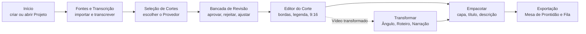

# Guia de uso do Clipes (v2)

Este guia percorre as telas da interface v2 na ordem em que você as usa, do primeiro Projeto à exportação final. Os termos em maiúscula (**Projeto**, **Fonte**, **Corte**, **Frase**, **Nota**, **Provedor** e outros) seguem o [glossário](../GLOSSARY.md).

A barra superior mostra as três etapas do Projeto: **Fontes e Transcrição**, **Cortes** e **Exportação**. Você pode trocar de etapa a qualquer momento — trabalhos longos continuam rodando em segundo plano.

## 1. Início: crie ou abra um Projeto

Na primeira abertura, o **Assistente de primeiro uso** aparece em dois passos:

1. Instala o FFmpeg e o **Motor de transcrição** local indicado para a sua placa de vídeo, memória e disco.
2. Configura um **Perfil de Provedor**, se você quiser usar um. Dá para pular este passo e configurar depois em **Configurações**.

Componentes de recursos específicos (`yt-dlp` e `deno` para URLs, YuNet para o Reenquadramento, Pocket TTS para a Narração) são baixados sob demanda quando você usa o recurso, sempre com tamanho, licença e conferência por SHA-256 à vista antes de confirmar.

Em **Início**, escolha:

- **Novo Projeto**: dê um nome e escolha a pasta onde salvar. Um **Projeto** é uma pasta `.clipes` portátil com um banco SQLite. Por padrão, use um por canal.
- **Abrir pasta `.clipes`**: abre um Projeto existente, **inclusive Projetos criados na v1**. Projetos recentes ficam listados; se uma pasta foi movida ou removida do disco, aparece como "Indisponível no disco" até você relocalizá-la.

## 2. Fontes e Transcrição

Em **Fontes**, importe um arquivo local ou cole a URL de um **VOD**. Na primeira vez que usar URL, o app oferece baixar `yt-dlp` e `deno`. Cada **Fonte** registra a **Permissão** do criador (quem autorizou, onde e para quê), usada automaticamente no crédito da descrição e nos avisos antes de exportar.

Abra a Fonte para gerar a **Transcrição** escolhendo o **Motor de transcrição**:

- **Local** (padrão): `faster-whisper` na GPU NVIDIA ou na CPU, a US$ 0,00. A Transcrição roda em blocos com checkpoint, então fechar o app não perde o progresso.
- **Groq** (opcional): transcrição remota. Só o áudio sai da máquina, sempre com estimativa de custo e confirmação antes.

Com a Transcrição pronta, o texto aparece **Frase** por **Frase**:

- Clique numa palavra (ou use **Ouvir aqui**) para reproduzir o trecho.
- `F2` corrige a grafia sem alterar os timestamps; `Ctrl+Z` desfaz.
- `Ctrl+F` busca na Transcrição inteira.
- Para processar várias Fontes em sequência, use a visão **Lotes** (**Lote de Fontes**) com teto de custo opcional: uma Fonte com erro do Provedor pausa sozinha enquanto as outras seguem.

## 3. Seleção de Cortes: configure e dispare

Em **Cortes**, escolha a Fonte transcrita e configure a seleção:

- Tipo de vídeo: **Corte direto** ou **Vídeo transformado**.
- Faixa de duração e sinais locais (energia do áudio e replay do chat do YouTube).

Antes de qualquer chamada ao **Provedor**, o app exibe um cartão com o **Perfil de Provedor** usado, se o texto sai da máquina e o custo estimado. A seleção roda em **Janelas de seleção** dimensionadas para caber na **Janela de contexto** do modelo, com progresso exibido por janela.

## 4. Bancada de Revisão: aprove os candidatos

A **Bancada de Revisão** lista os candidatos à esquerda e exibe, à direita, o preview 9:16 com a **Nota** detalhada por eixos e o motivo escrito de cada eixo. Você pode revisar sem tirar a mão do teclado:

| Tecla | Ação |
|---|---|
| `A` / `R` | Aprovar / rejeitar o candidato |
| `I` / `O` | Recuar a borda inicial / avançar a borda final em uma Frase |
| `Ctrl+Z` | Desfazer a última decisão ou ajuste |
| `Enter` | Abrir o Corte no editor |

**Refazer com outro Perfil de Provedor** cria uma nova **Revisão da execução** sem perder as revisões anteriores nem as decisões já tomadas.

## 5. Editor do Corte

Cada **Corte** aprovado abre com a barra de contexto no topo (`Alt+PageUp` e `Alt+PageDown` navegam entre os aprovados), a **Transcrição do Corte** à esquerda (recolhível com `Ctrl+[`), o palco 9:16 no centro com controles de transporte e a timeline compacta embaixo.

A barra de cinco ações abre popovers sob demanda (`Ctrl+]` abre e fecha o último):

- **Enquadrar**: sugestão automática de rosto (YuNet, baixado ao usar), cinco **Layouts** e crop manual com keyframes (**Reenquadramento**).
- **Legenda**: karaokê com texto e estilo editáveis por Corte e tradução PT-BR ↔ EN.
- **Silêncios**: remoção de silêncios, reversível.
- **Áudio**: trilha sonora, efeitos e mixagem da **Narração**.
- **Histórico**: desfazer e instantâneos da edição.

As bordas sempre encaixam em **Frase**; segurar `Alt` libera o ajuste por quadro como exceção. O autosave grava a cada segundo e o app confere o salvamento antes de sair da tela ou fechar a janela. A Fonte original nunca é alterada.

## 6. Transformar (apenas para Vídeo transformado)

No **Vídeo transformado**, a aba **Transformar** conduz três passos com trava humana obrigatória antes da Narração (veja o [ADR-0001](adr/0001-dois-tipos-de-video-e-regras-de-transformacao.md)):

1. **Ângulo**: escolha a perspectiva do comentário.
2. **Roteiro em blocos**: o Provedor sugere, você revisa e aprova. Só um **Roteiro** aprovado libera a Narração.
3. **Narração**: voz sintetizada localmente (Pocket TTS, baixado no primeiro uso), gravação com teleprompter ou áudio importado, com limpeza de voz e revisão do alinhamento por palavra.

O **Corte direto** pula esta etapa e vai direto do editor para **Empacotar** (mas um Corte direto aprovado pode ser convertido em Vídeo transformado quando necessário).

## 7. Empacotar

A aba **Empacotar** prepara o **Empacotamento** para publicação:

- Capa: escolha um quadro do preview e exporte em PNG.
- Título, descrição com o crédito da Fonte (protegido contra remoção acidental), tags, hashtags e capítulos do YouTube.
- Validadores de tamanho avisam antes de estourar limites das plataformas.

Você pode preencher tudo manualmente ou pedir sugestão ao **Provedor** — todo campo continua editável.

## 8. Exportação, Fila de Jobs e Console ao vivo

Há dois caminhos para exportar:

- **Um Corte**: pressione `Ctrl+E` na tela do Corte. Um painel de conferência mostra Permissão, avisos de monetização e de glifos antes de renderizar.
- **Vários Cortes**: na etapa **Exportação**, a **Mesa de Prontidão** reúne todos os aprovados em grade com título, capa e avisos. Dali você dispara um lote MP4 ou usa **Exportar só este** em um cartão.

A exportação usa FFmpeg e libass, mantendo paridade entre o preview e o arquivo final, loudness normalizado em duas passagens (-14 LUFS) e encoder de hardware detectado (NVENC, QSV, AMF ou fallback para x264 com aviso explícito). O histórico de lotes fica na mesma tela.

- **Fila de Jobs** (`Ctrl+J`, de qualquer tela): acompanha transcrições, seleções, downloads e exportações. Permite cancelar jobs, pausar e retomar lotes e decidir o que fazer com uma chamada paga cujo resultado ficou incerto (ela nunca é repetida sozinha).
- **Console ao vivo** *(novidade da v2.0.1)*: acessível pelo botão **Console** na barra inferior, inline em **Configurações → Componentes** ou filtrado por job a partir da Fila de Jobs. Exibe em tempo real a saída de FFmpeg, transcrição, instalação de Componentes e Tarefas de IA, com chaves de API, tokens e caminhos sensíveis ocultados automaticamente.

## 9. Relatos e Sobre

- **Relatos** (`#/relatos`): monta um relato de problema, ideia ou proposta de Provedor com um diagnóstico filtrado que você revisa antes de enviar. Nada sai sozinho ([ADR-0006](adr/0006-relato-de-problemas-sem-telemetria.md)).
- **Sobre** (`#/sobre`): versão instalada, busca e instalação de atualizações assinadas, e licenças.

## Atalhos de teclado

| Atalho | Ação |
|---|---|
| `Ctrl+K` | Paleta de comandos |
| `Ctrl+J` | Fila de Jobs |
| `Ctrl+,` | Configurações |
| `F6` | Pular entre regiões da janela (incluindo o Console ao vivo) |
| `?` ou `Ctrl+/` | Folha de atalhos |
| `Ctrl+E` | Exportar o Corte atual |
| `Ctrl+[` | Recolher ou expandir a Transcrição no Editor |
| `Ctrl+]` | Abrir ou fechar o último popover do Editor |
| `Alt+PageUp` / `Alt+PageDown` | Navegar entre Cortes aprovados no Editor |

No macOS (ainda sem instalador), `Ctrl` equivale a `Cmd`. Em **Configurações → Aparência e teclado** você remapeia os atalhos e pode desativar teclas de uma letra só (`A`, `R`, `I`, `O`…) se atrapalharem a digitação.
