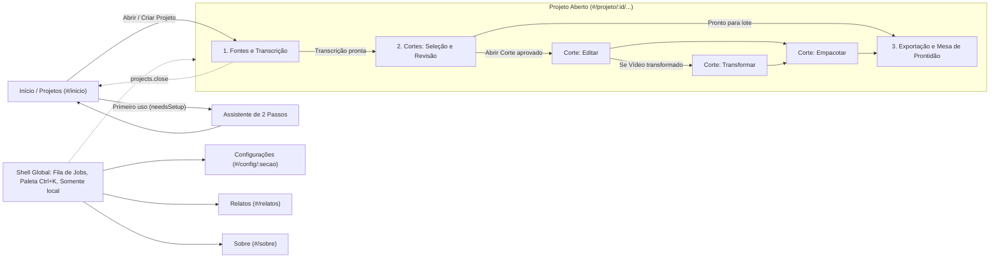

# Arquitetura de Informação do Front v2 — Clipes

Este documento define a espinha estrutural do novo front-end (v2) do Clipes. Ele traduz o inventário dos **237 comandos** do núcleo Rust ([funcionalidades.md](../funcionalidades.md)), os **ADRs** ([0001](../../adr/0001-dois-tipos-de-video-e-regras-de-transformacao.md) a [0010](../../adr/0010-perfis-multiplos-de-provedor-tarefa-para-perfil-e-somente-local.md)), o vocabulário canônico ([GLOSSARY.md](../../../GLOSSARY.md)), a pesquisa de mercado e acessibilidade ([ux-mapa-total.md](../../research/2026-11-17-ux-mapa-total.md)) e as decisões do dev de 17/11/2026 em um mapa navegável único para a especificação detalhada de cada tela.

> **Nota para leitura a partir do backend:** O front roda em React dentro de uma WebView do Tauri e conversa com o núcleo Rust exclusivamente por `core_dispatch(nome, json)` e pelo evento unidirecional `core-progress`. Onde este documento usa termos de front-end, eles são definidos na primeira ocorrência.
>
> **Interfaces canônicas de componentes:** Os nomes e props canônicos dos componentes compartilhados são os definidos no catálogo de [02-consolidacao.md](./02-consolidacao.md#cat%C3%A1logo-de-componentes-compartilhados); nomes ou props divergentes que eventualmente apareçam nos pacotes A–F seguem esse catálogo.

---

## 1. Princípios

1. **Separar Início, macro-etapas do Projeto e edição do Corte em largura total.** A v1 empilhava ~6.400 linhas numa coluna `max-w-4xl` com scroll único. A v2 separa a escolha de Projeto em uma tela inicial dedicada e usa 100% da janela para as etapas e painéis lado a lado ([ux-mapa-total.md](../../research/2026-11-17-ux-mapa-total.md#1-navega%C3%A7%C3%A3o-etapas-vs-%C3%A1rea-de-trabalho), [ux-editores-de-video-desktop.md](../../research/2026-11-17-ux-editores-de-video-desktop.md)).
2. **Navegação por etapas não bloqueantes com URL própria.** O usuário pode ter uma Fonte em revisão de Cortes enquanto outra ainda transcreve ou exporta. As etapas no topo mostram contadores de estado e nunca trancam a troca de área ([ux-mapa-total.md](../../research/2026-11-17-ux-mapa-total.md#1-navega%C3%A7%C3%A3o-etapas-vs-%C3%A1rea-de-trabalho), [ux-ferramentas-de-cortes-ia.md](../../research/2026-11-17-ux-ferramentas-de-cortes-ia.md)).
3. **Quatro zonas sincronizadas na edição, com painéis acoplados e colapsáveis.** Transcrição à esquerda, Preview 9:16 no centro, Inspetor contextual em abas à direita e Timeline na base mantêm ligação bidirecional palavra ↔ agulha ↔ Corte. Painéis laterais abrem e fecham apenas por clique ou atalho, nunca por *hover* na borda, evitando obstrução de foco (WCAG 2.4.11) ([ux-editores-por-transcricao.md](../../research/2026-11-17-ux-editores-por-transcricao.md), [ux-acessibilidade-e-visual.md](../../research/2026-11-17-ux-acessibilidade-e-visual.md)).
4. **Corrigir grafia separado de cortar vídeo, com edições não destrutivas.** Clicar numa palavra posiciona o vídeo; `F2`/`Enter` corrige o texto da legenda sem mexer em tempos; silêncios removidos continuam visíveis e reversíveis sem depender só de desfazer; presets visuais nunca apagam ajustes manuais por palavra ([ux-editores-por-transcricao.md](../../research/2026-11-17-ux-editores-por-transcricao.md), [ux-ferramentas-de-cortes-ia.md](../../research/2026-11-17-ux-ferramentas-de-cortes-ia.md)).
5. **Bifurcação limpa entre Corte direto e Vídeo transformado.** O fluxo de **Corte direto** (**Canal de cortes**) oculta a cadeia Ângulo → Roteiro → Narração (com ação discreta para converter o Corte se o usuário mudar de ideia). No **Vídeo transformado** (**Canal dark**), a trava humana no loop (`narrationAllowed`) é explícita e pedagógica ([ADR-0001](../../adr/0001-dois-tipos-de-video-e-regras-de-transformacao.md), [ux-mapa-total.md](../../research/2026-11-17-ux-mapa-total.md#onde-o-clipes-%C3%A9-diferente)).
6. **Fila global única e não bloqueante para todo trabalho longo.** Um único monitor central escuta `core-progress` e unifica jobs persistidos do Projeto, lotes e downloads globais, com progresso determinístico, retomada visível e resolução humana explícita para jobs `uncertain` ([ux-padroes-app-desktop-ia.md](../../research/2026-11-17-ux-padroes-app-desktop-ia.md), [ADR-0005](../../adr/0005-projeto-portatil-com-sqlite.md)).
7. **Transparência financeira e de privacidade antes de cada disparo.** Toda ação que chama Provedor ou Motor remoto exibe antes: Perfil de Provedor resolvido, se o texto/áudio sai da máquina, estimativa em USD ou cota de CLI, teto restante do orçamento e selo permanente quando **Somente local** estiver ativo ([ux-padroes-app-desktop-ia.md](../../research/2026-11-17-ux-padroes-app-desktop-ia.md), [ADR-0009](../../adr/0009-custo-orcamento-e-auditoria-de-chamadas-de-ia.md), [ADR-0010](../../adr/0010-perfis-multiplos-de-provedor-tarefa-para-perfil-e-somente-local.md)).
8. **Onboarding curto orientado a hardware e instalação *just-in-time*.** O primeiro uso instala só o essencial (FFmpeg e Motor de transcrição local compatível com GPU/RAM/disco) e configura Provedor; `yt-dlp`/`deno`, `YuNet` e `pocket-tts` chegam apenas quando o usuário aciona URL, reenquadramento ou Narração, sem expor jargões como `int8_float16` ou `SHA-256` na camada principal ([ux-padroes-app-desktop-ia.md](../../research/2026-11-17-ux-padroes-app-desktop-ia.md)).
9. **Estados padronizados e erros humanos acionáveis.** Nenhuma tela retorna vazio durante carregamento nem imprime `CoreError.code` cru. Toda visão segue a mesma máquina de estados e traduz códigos de erro em explicação clara com botão de recuperação ([ux-mapa-total.md](../../research/2026-11-17-ux-mapa-total.md#6-estados-vazio-carregando-e-erro), [90-inventario-ui-atual.md](../funcionalidades/90-inventario-ui-atual.md)).
10. **Operação integral por teclado e conformidade WCAG 2.2 AA.** Paleta `Ctrl/Cmd+K`, salto entre regiões por `F6`, atalhos de NLE sem conflitos de escopo, opção de desligar/exigir modificador em teclas únicas (SC 2.1.4), alvos ≥ 24 px (SC 2.5.8) e índice textual equivalente à timeline ([ux-acessibilidade-e-visual.md](../../research/2026-11-17-ux-acessibilidade-e-visual.md), [PRODUCT.md](../../../design-system/PRODUCT.md)).

---

## 2. Mapa de telas

### Árvore de superfícies e mapeamento de comandos

Todo comando com valor direto para o usuário registrado nos arquivos de `docs/produto/funcionalidades/` tem destino explícito abaixo. Comandos internos do harness de agentes ou auxiliares sem UI própria são identificados à parte.

* **Shell Global** (presente em volta de todas as rotas)
  * **Barra Superior**: exibe Projeto ativo (ou atalho para Início), fecha/troca Projeto (`projects.close`, `projects.recent`, `projects.current`, `projects.open`), navega pelas 3 macro-etapas do Projeto, mostra o selo **Somente local** (`projects.local_only.get`), o gatilho da **Fila de jobs** e o gatilho da **Paleta de comandos** (`Ctrl/Cmd+K`). — Ref.: [02](../funcionalidades/02-projetos-e-fontes.md), [07](../funcionalidades/07-provedores-jobs-e-eventos.md).
  * **Barra de Status**: exibe estado do autosave do editor (`editor_saved` / `editor_save_failed`), resumo de job em execução ou pausa por orçamento, aviso de backup automático falho (`projects.current.backupWarning`) e atalho contextual da tela. — Ref.: [02](../funcionalidades/02-projetos-e-fontes.md), [05](../funcionalidades/05-editor.md), [07](../funcionalidades/07-provedores-jobs-e-eventos.md).
  * **Painel / Gaveta Global da Fila de Jobs** (acessível de qualquer rota via barra superior ou `Ctrl/Cmd+J`): lista jobs do Projeto (`jobs.list`, `jobs.cancel`, `jobs.estimate`, `jobs.retry`, `jobs.discard`, `jobs.redo.estimate`, `jobs.redo`, `jobs.result`), **Lotes de Fontes** ativos (`batches.list`, `batches.pause`, `batches.resume`, `batches.cancel`, `batches.item.resume`), **Lotes de exportação** ativos (`export.batch.list`, `export.batch.cancel`), pausas de orçamento (`jobs.budget.get`, `jobs.budget.continue`) e downloads globais em andamento (`components.cancel`, `tts.models.cancel`, `sources.url.cancel`, `sources.cancel`). — Ref.: [01](../funcionalidades/01-instalacao-e-sistema.md), [02](../funcionalidades/02-projetos-e-fontes.md), [06](../funcionalidades/06-roteiro-narracao-e-saida.md), [07](../funcionalidades/07-provedores-jobs-e-eventos.md).
  * **Paleta de Comandos (`Ctrl/Cmd+K`)**: busca e dispara ações de navegação, edição e configuração registradas via `useComandos`. — Ref.: [DESIGN.md](../../../design-system/DESIGN.md).
  * **Central de Notificações e Diálogos Globais**: avisos não bloqueantes (`toast`), `<ConfirmDialog>` para ações destrutivas ou pagas, diálogo de consentimento remoto e aviso de atualização do app (`UpdateNotice`).

* **Início / Projetos** (`#/inicio`)
  * *Propósito:* Criar ou abrir um **Projeto** portátil `.clipes` e retomar Projetos recentes verificando sua disponibilidade no disco.
  * *Comandos:* `projects.recent`, `projects.create`, `projects.open`, `projects.current`, `assistant.status` (para disparar o assistente no primeiro uso). — Ref.: [02](../funcionalidades/02-projetos-e-fontes.md), [04](../funcionalidades/04-selecao-de-cortes.md).

* **Assistente de Primeiro Uso** (`#/assistente?passo=1|2` — rota dedicada com `<Tela modoMinimo>`, aberta na largada quando `needsSetup === true` ou reaberta por Configurações)
  * *Propósito:* Preparar o mínimo funcional em 2 passos — (1) FFmpeg + Motor de transcrição local recomendado para GPU/RAM/disco e (2) Provedor padrão e Perfis de Provedor — deixando `yt-dlp`/`deno`, `YuNet` e `pocket-tts` para instalação *just-in-time*.
  * *Comandos:*
    * Passo 1 (Essencial e Hardware): `components.ffmpeg.status`, `components.ffmpeg.system`, `components.manifest`, `components.download`, `components.cancel`, `components.worker.status`, `components.worker.install`, `components.models.manifest`, `components.models.download`, `transcription.hardware.status`, `transcription.hardware.probe`, `transcription.grouping`.
    * Passo 2 (Provedores): `assistant.status`, `assistant.detect`, `assistant.default.set`, `assistant.complete`, `provider.configure`, `provider.key.set`, `provider.confirm`, `provider.test`, `provider.cli.configure`, `provider.cli.confirm`, `provider.profiles.list`. — Ref.: [01](../funcionalidades/01-instalacao-e-sistema.md), [03](../funcionalidades/03-transcricao.md), [04](../funcionalidades/04-selecao-de-cortes.md), [07](../funcionalidades/07-provedores-jobs-e-eventos.md).

* **Macro-etapa 1: Fontes e Transcrição** (`#/projeto/:id/fontes?sub=fontes|lotes` e `#/projeto/:id/fontes/:fonteId`)
  * *Propósito:* Importar Fontes locais ou por URL (instalando `yt-dlp`/`deno` sob demanda), gerenciar Permissão e integridade no disco, executar Transcrição (individual ou em Lote de Fontes) e ler/corrigir/buscar o texto transcrito.
  * *Superfícies internas:*
    * **Lista e Entrada de Fontes**: inspeção prévia, importação local, download por URL (com aceite único de termos e instalador *just-in-time* de `yt-dlp`/`deno`), verificação SHA-256, relocalização de Fonte `offline`/`changed` e registro de **Permissão**.
    * **Lotes de Fontes** (painel/sub-visão): criar lote (1–500 Fontes), definir teto de custo e acompanhar/pausar/retomar itens.
    * **Detalhe da Fonte selecionada (Transcrição)**: cartão de escolha do **Motor de transcrição** (`Local US$ 0,00` com amostra de 30 s vs. `Groq` remoto com estimativa e consentimento + opção automática/manual de agrupamento VAD #279 com aviso CPU/GPU), progresso por blocos de 10 min (`transcription.blocks`), replay de chat e medição de energia (`chat.*`, `energy.status`, `energy.start`), **Transcrição** virtualizada com correção `F2`/`Enter`, desfazer/refazer e busca global FTS5.
  * *Comandos:* `sources.inspect`, `sources.import`, `sources.list`, `sources.hash`, `sources.relocate`, `sources.cancel`, `sources.language.set`, `sources.permission.set`, `sources.url.settings.get`, `sources.url.settings.set`, `sources.url.download`, `sources.url.cancel`, `components.ffmpeg.status`, `components.ytdlp.status`, `components.deno.status`, `components.manifest`, `components.download`, `components.cancel`, `batches.create`, `batches.get`, `batches.list`, `batches.pause`, `batches.resume`, `batches.cancel`, `batches.item.resume`, `jobs.budget.set`, `jobs.budget.continue`, `jobs.preview`, `chat.fetch`, `chat.status`, `energy.start`, `energy.status`, `transcription.hardware.status`, `transcription.grouping`, `transcription.estimate`, `transcription.groq.info`, `transcription.groq.confirm`, `transcription.groq.estimate`, `transcription.start`, `transcription.status`, `transcription.blocks`, `transcription.segment`, `transcription.timeline`, `transcription.correct`, `transcription.undo`, `transcription.redo`, `transcription.corrections`, `transcription.search`, `jobs.cancel`, `channel_profile.get`. — Ref.: [01](../funcionalidades/01-instalacao-e-sistema.md), [02](../funcionalidades/02-projetos-e-fontes.md), [03](../funcionalidades/03-transcricao.md), [04](../funcionalidades/04-selecao-de-cortes.md), [07](../funcionalidades/07-provedores-jobs-e-eventos.md).

* **Macro-etapa 2: Cortes (Seleção e Revisão)** (`#/projeto/:id/cortes` e `#/projeto/:id/cortes/revisao/:runId?`)
  * *Propósito:* Configurar e disparar a seleção de Cortes de uma Fonte transcrita, comparar **Revisões da execução**, revisar candidatos com preview 9:16 e eixos da **Nota**, ajustar bordas por **Frase** e aprovar Cortes para edição.
  * *Superfícies internas:*
    * **Configurador de Seleção**: tipo de vídeo (herdado do Perfil de canal ou sobrescrito), faixa de duração (`minUs`/`maxUs`), sinais locais (`energy.status`/`energy.start`, `chat.status`), compatibilidade da **Janela de contexto** (`provider.selection_state`), estimativa prévia (`selection.estimate`), acompanhamento por Janela e seletor de **Revisão da execução** (`selection.get { revision }`).
    * **Bancada Mestre-Detalhe de Revisão**: lista filtrável e ordenável de candidatos à esquerda (pendentes/aprovados/rejeitados, filtro por Nota) + preview de proxy 9:16, detalhamento dos eixos da Nota (destacando **Espaço para comentário** no Vídeo transformado), ajuste rápido `±1 Frase` (`I`/`O`), Aprovar/Rejeitar/Desfazer, ação **"Refazer com outro Perfil de Provedor"** (`selection.redo` / `jobs.redo`) e atalho para abrir o Corte.
  * *Comandos:* `channel_profile.get`, `sources.list`, `energy.status`, `energy.start`, `chat.status`, `provider.selection_state`, `provider.profiles.list`, `selection.estimate`, `selection.start`, `selection.list`, `selection.get`, `selection.cancel`, `selection.redo`, `selection.resume`, `selection.review`, `selection.decide`, `selection.adjust`, `selection.undo`, `jobs.redo.estimate`, `jobs.redo`, `proxy.request`, `proxy.status`, `jobs.cancel`. — Ref.: [02](../funcionalidades/02-projetos-e-fontes.md), [03](../funcionalidades/03-transcricao.md), [04](../funcionalidades/04-selecao-de-cortes.md), [07](../funcionalidades/07-provedores-jobs-e-eventos.md).

* **Tela do Corte** (`#/projeto/:id/corte/:corteId/...`, onde `:corteId` é `candidateId` para Cortes da seleção ou `avulso-<sourceId>-<startId>-<endId>` para Cortes avulsos sem `Transformar`/`Empacotar`)
  * *Cabeçalho `<ContextoCorte>`*: exibe `"Corte {i}/{N}: {título}"` (ou `"Corte #{id}"` se avulso), navegação `< Anterior | Próximo aprovado >` (`Alt+PageUp` / `Alt+PageDown`, usando a execução de `?run=:runId` quando presente ou todos os aprovados do Projeto), tipo do Corte (**Corte direto** com ação discreta *"Converter em Vídeo transformado"* desabilitada com tooltip até existir comando no núcleo — ver Seção 11 — vs. **Vídeo transformado**), botão **"Exportar Corte"** (`Ctrl/Cmd+E`, `export.start`) e abas do Corte:
  * **Sub-aba `Editar`** (`#/projeto/:id/corte/:corteId/editar`)
    * *Propósito:* Ajustar bordas (por Frase ou quadro com `Alt`), revisar silêncios, definir enquadramento 9:16 (inclusive YuNet *just-in-time*), estilizar/traduzir legendas, mixar trilha/SFX e posicionar Narração na timeline.
    * *Zonas:* Transcrição do Corte + Índice textual da timeline (painel acoplado esquerdo), Palco 9:16 com legendas ao vivo (centro), Inspetor em abas (painel acoplado direito: `Enquadramento`, `Legendas e Tradução`, `Silêncios`, `Áudio e SFX`, `Histórico/Snapshots`) e Timeline de proxy com onda/miniaturas na base.
    * *Comandos:* `editor.open`, `editor.sentences`, `editor.timeline`, `editor.timeline_status`, `editor.wave`, `editor.adjust`, `editor.undo`, `editor.redo`, `editor.flush`, `editor.snapshots`, `editor.silences.*`, `editor.crop.set_layout`, `editor.crop.set_suggested`, `editor.crop.set_edits`, `reframe.start`, `reframe.status` (com `components.models.manifest`/`download` *just-in-time* para `yunet`), `editor.montage.set_start`, `editor.audio.*`, `audio.import`, `audio.list`, `audio.license.set`, `audio.delete`, `captions.override`, `captions.remap_status`, `captions.style.set`, `captions.style.preset`, `captions.style.default`, `captions.track.set`, `translation.get`, `translation.estimate`, `translation.start`, `translation.track.set`, `translation.edit`, `export.captions`, `proxy.request`, `proxy.status`, `transcription.correct`, `guardrails.check`, `export.settings`, `export.start`, `export.status`, `jobs.cancel`. — Ref.: [01](../funcionalidades/01-instalacao-e-sistema.md), [02](../funcionalidades/02-projetos-e-fontes.md), [03](../funcionalidades/03-transcricao.md), [05](../funcionalidades/05-editor.md), [06](../funcionalidades/06-roteiro-narracao-e-saida.md).
  * **Sub-aba `Transformar`** (`#/projeto/:id/corte/:corteId/transformar` — visível apenas para **Vídeo transformado**)
    * *Propósito:* Conduzir o humano no loop pelos 3 passos obrigatórios de Transformação: **1. Ângulo** → **2. Roteiro em blocos** (com trava de aprovação) → **3. Narração** (`pocket-tts` *just-in-time*, gravação com teleprompter ou importação, limpeza Antes/Depois e revisão de alinhamento).
    * *Comandos:* `angles.get`, `angles.estimate`, `angles.generate`, `angles.choose`, `script.estimate`, `script.generate`, `script.get`, `script.edit`, `script.approve`, `script.regenerate`, `script.narration_allowed`, `narration.get`, `narration.generate`, `narration.regenerate_block`, `narration.record_block`, `narration.trim_block`, `narration.discard_draft`, `narration.import`, `narration.align`, `narration.align_block`, `narration.review`, `narration.cleanup.set`, `narration.cleanup.prepare`, `tts.catalog`, `tts.models.download`, `tts.models.cancel`, `components.pocket_tts.status`, `components.download`, `components.cancel`, `provider.profiles.list`, `jobs.cancel`. — Ref.: [01](../funcionalidades/01-instalacao-e-sistema.md), [04](../funcionalidades/04-selecao-de-cortes.md), [06](../funcionalidades/06-roteiro-narracao-e-saida.md).
  * **Sub-aba `Empacotar`** (`#/projeto/:id/corte/:corteId/empacotar`)
    * *Propósito:* Escolher e exportar o quadro de capa (PNG) e editar título, descrição (com crédito não editável da Permissão), tags, hashtags e capítulos do YouTube com validadores determinísticos.
    * *Comandos:* `thumbnail.estimate`, `thumbnail.suggest`, `thumbnail.get`, `thumbnail.choose`, `thumbnail.export`, `packaging.estimate`, `packaging.generate`, `packaging.get`, `packaging.edit`, `packaging.refresh_chapters`, `proxy.request`, `proxy.status`, `guardrails.check`, `guardrails.ack_direct_notice`, `export.settings`, `export.start`, `export.status`. — Ref.: [04](../funcionalidades/04-selecao-de-cortes.md), [06](../funcionalidades/06-roteiro-narracao-e-saida.md).

* **Macro-etapa 3: Exportação (Mesa de prontidão e Lotes)** (`#/projeto/:id/exportacao?sub=prontidao|lotes`; `#/projeto/:id/exportacao/lotes` mantida como redirect)
  * *Propósito:* Conferir em grade todos os Cortes aprovados antes de renderizar em massa — título, capa, status de Permissão, avisos de `guardrails.check` e glifos —, permitir exportação individual rápida pelo cartão (*"Exportar só este"*, abrindo o mesmo modal pré-exportação de `guardrails.check` do `<ContextoCorte>`) e disparar/acompanhar lotes de exportação MP4.
  * *Comandos:* `sources.list`, `selection.list`, `selection.review`, `packaging.get`, `packaging.edit`, `thumbnail.get`, `guardrails.check`, `guardrails.ack_direct_notice`, `export.captions`, `export.settings`, `export.start`, `export.batch.start`, `export.batch.status`, `export.batch.list`, `export.batch.cancel`, `export.status`, `export.encoder.status`. — Ref.: [02](../funcionalidades/02-projetos-e-fontes.md), [04](../funcionalidades/04-selecao-de-cortes.md), [06](../funcionalidades/06-roteiro-narracao-e-saida.md).

* **Configurações** (`#/config/:secao`, atalho `Ctrl/Cmd+,`)
  * *Propósito:* Centralizar preferências do aplicativo e do Projeto aberto em seções laterais claras, sem rolagem gigante.
  * *Seções:*
    1. **Provedores e Tarefas de IA** (`#/config/provedores`): Perfis de Provedor, chaves no keyring, CLIs, Groq para Transcrição remota, matriz Tarefa de IA × Perfil + Somente local por tarefa, sondagem de contexto (`selection_state`) e reabertura do Assistente. — Comandos: `provider.profiles.list`, `provider.profiles.remove`, `provider.status`, `provider.configure`, `provider.key.set`, `provider.key.remove`, `provider.confirm`, `provider.test`, `provider.context.get`, `provider.selection_state`, `provider.cli.status`, `provider.cli.configure`, `provider.cli.confirm`, `assistant.status`, `assistant.detect`, `assistant.default.set`, `assistant.tasks`, `assistant.task.set`, `assistant.local_only.set`, `transcription.groq.key.*`. — Ref.: [03](../funcionalidades/03-transcricao.md), [04](../funcionalidades/04-selecao-de-cortes.md), [07](../funcionalidades/07-provedores-jobs-e-eventos.md).
    2. **Custos, Orçamentos e Auditoria** (`#/config/custos`, acessível mesmo sem Projeto aberto para `Tabela de Preços` e `Estimador`; abas dependentes de Projeto exibem `<EstadoTela tipo="vazio">` acionável): tabela de preços e sobrescritas, estimador, tetos de orçamento do Projeto aberto, consumo real por chamada e trilha de auditoria SHA-256 (sem texto). — Comandos: `provider.prices.get`, `provider.prices.set`, `provider.prices.clear`, `provider.cost.estimate`, `provider.cost.list`, `provider.audit.list`, `jobs.budget.get`, `jobs.budget.set`, `jobs.budget.continue`. — Ref.: [07](../funcionalidades/07-provedores-jobs-e-eventos.md).
    3. **Componentes e Armazenamento** (`#/config/componentes`): FFmpeg (gerenciado ou do sistema), `yt-dlp`, `deno`, `pocket-tts`, Worker Python, catálogo assinado, modelos de ML/TTS, hardware de Transcrição + agrupamento VAD (#279 com aviso CPU/GPU) e pastas/limite LRU de cache (com aviso de que mudar `data_dir` não move arquivos já baixados). — Comandos: `components.manifest`, `components.download`, `components.cancel`, `components.settings.get`, `components.settings.set`, `components.ffmpeg.status`, `components.ffmpeg.system`, `components.deno.status`, `components.pocket_tts.status`, `components.ytdlp.status`, `components.ytdlp.update`, `components.worker.status`, `components.worker.install`, `components.catalog.status`, `components.catalog.check`, `components.models.manifest`, `components.models.download`, `tts.catalog`, `tts.models.choose`, `tts.models.download`, `tts.models.cancel`, `transcription.hardware.status`, `transcription.hardware.probe`, `transcription.hardware.choose`, `transcription.grouping`. — Ref.: [01](../funcionalidades/01-instalacao-e-sistema.md), [03](../funcionalidades/03-transcricao.md).
    4. **Exportação e Encoder** (`#/config/exportacao`): detecção e escolha manual/automática de encoder H.264. — Comandos: `export.encoder.status`, `export.encoder.detect`, `export.encoder.set`. — Ref.: [06](../funcionalidades/06-roteiro-narracao-e-saida.md).
    5. **Aparência e Teclado** (`#/config/aparencia`): Tema (`Escuro`, `Claro`, `Sistema`), Alto Contraste (`[data-contrast="high"]`), escala da UI (`100%` / `115%`), idioma (`PT-BR` / `EN`), mapa pesquisável de atalhos, remapeamento e interruptor WCAG 2.1.4 (desligar ou exigir modificador em teclas únicas). — Ref.: [DESIGN.md](../../../design-system/DESIGN.md), [ux-acessibilidade-e-visual.md](../../research/2026-11-17-ux-acessibilidade-e-visual.md).
    6. **Projeto atual** (`#/config/projeto` — habilitada quando há Projeto aberto): **Perfil de canal** (`channel_profile.get`, `channel_profile.set`, `channel_profile.languages`, `tts.catalog`), veto **Somente local** do Projeto (`projects.local_only.get`, `projects.local_only.set`) e **Backups rotativos** (`backups.settings.get`, `backups.settings.set`, `backups.create`, `backups.list`, `backups.restore`). — Ref.: [01](../funcionalidades/01-instalacao-e-sistema.md), [02](../funcionalidades/02-projetos-e-fontes.md), [04](../funcionalidades/04-selecao-de-cortes.md).

* **Relatos e Diagnóstico** (`#/relatos`)
  * *Propósito:* Montar relatos de problema, ideia ou proposta de Provedor com diagnóstico local sanitizado, registro técnico de sonda de hardware e exportação `.txt` sem telemetria automática.
  * *Comandos:* `diagnostic.get`, `diagnostic.export`, `transcription.hardware.diagnostic`. — Ref.: [01](../funcionalidades/01-instalacao-e-sistema.md), [03](../funcionalidades/03-transcricao.md), [ADR-0006](../../adr/0006-relato-de-problemas-sem-telemetria.md).

* **Sobre e Atualizações** (`#/sobre`)
  * *Propósito:* Exibir versão instalada, verificar/aplicar atualizações do app e mostrar licenças (`LICENSE` e `THIRD_PARTY_NOTICES.md`).
  * *Comandos:* `app.version` (e `@tauri-apps/plugin-updater`). — Ref.: [01](../funcionalidades/01-instalacao-e-sistema.md).

> **Comandos internos / sem tela dedicada (10):** `documents.validate`, `provider.capabilities`, `provider.structured`, `provider.cost.run`, `editor.crop.example` (uso de teste/harness); `editor.range`, `editor.crop.get`, `editor.crop.evaluate`, `editor.montage.get`, `captions.overrides`, `captions.style.get`, `transcription.sentences`, `transcription.words`, `proxy.map_time` (cobertos no cliente pelas respostas agregadas de `editor.open`, `export.captions`, `transcription.timeline` e funções matemáticas puras — ver Seção 10).

### Diagrama de navegação

---

## 3. Rotas

> **O que é "rota":** É o endereço interno após `#` na URL da janela (ex.: `#/projeto/meu-canal/cortes`). Como o app roda em WebView local, usar *hash routes* preserva o histórico de **Voltar/Avançar** e permite recarregar a página ou abrir diretamente uma tela durante testes sem depender de um servidor web.

| Rota (hash) | Parâmetros | Ao entrar | Ao sair | Guarda de rota e redirecionamento |
|---|---|---|---|---|
| `#/inicio` | — | Chama `projects.recent`, `projects.current` e `assistant.status`. Se `needsSetup` for verdadeiro na primeira abertura, abre o **Assistente de Primeiro Uso**. | — | Se houver Projeto ativo e o usuário navegou sem fechar, continua acessível para trocar/fechar (`projects.close`). |
| `#/assistente` | `?passo=1\|2` | Rota dedicada com `<Tela modoMinimo>`; carrega `components.ffmpeg.status`, `transcription.hardware.status`, `assistant.status`, `assistant.detect`. | Se concluído ou pulado, chama `assistant.complete` (a menos que cancelado sem concluir em reabertura manual). | Nenhuma; acessível a qualquer momento para reconfiguração. |
| `#/projeto/:id/fontes` | `:id`, `?sub=fontes\|lotes` | Garante Projeto aberto (`projects.current` / `projects.open`), carrega `sources.list`, `batches.list`, `channel_profile.get`. | — | **Sem Projeto aberto** → redireciona para `#/inicio`. |
| `#/projeto/:id/fontes/:fonteId` | `:id`, `:fonteId` | Além do acima, carrega `transcription.status`, `transcription.blocks`, `energy.status`, `chat.status`, `transcription.timeline` (se houver Transcrição). | — | **Sem Projeto** → `#/inicio`. **`:fonteId` inexistente** → `#/projeto/:id/fontes` com aviso. |
| `#/projeto/:id/cortes` | `:id`, `?fonte=:fonteId&run=:runId&rev=:n` | Carrega `sources.list`, `selection.list`, `channel_profile.get`, `provider.selection_state`. | — | **Sem Projeto** → `#/inicio`. Se nenhuma Fonte tiver Transcrição concluída, exibe estado vazio com CTA levando para `#/projeto/:id/fontes`. |
| `#/projeto/:id/cortes/revisao/:runId` | `:id`, `:runId`, `?rev=:n&corte=:cid` | Carrega `selection.get { run, revision }`, `selection.review`, inicia `proxy.request` para o candidato selecionado. | — | **Sem Projeto** → `#/inicio`. **Execução ausente** → `#/projeto/:id/cortes`. |
| `#/projeto/:id/corte/:corteId/editar` | `:id`, `:corteId` (`candidateId` ou `avulso-<sourceId>-<startId>-<endId>`), `?run=:runId` | Chama `editor.open`, `editor.sentences`, `editor.timeline`, `editor.wave`, `export.captions`, `audio.list`, `translation.get`. | **Obrigatório:** chama `editor.flush` antes de desmontar. Se falhar na navegação SPA, cancela a saída e abre `<ConfirmDialog>` com 3 ações: *"Tentar salvar novamente"* (primário), *"Continuar editando"* e *"Sair descartando alterações não salvas"* (perigo). | **Sem Projeto** → `#/inicio`. **Corte não aprovado / ausente** → `#/projeto/:id/cortes`. **Fonte `offline` ou `changed`** → abre em modo somente-leitura de texto/bordas com banner de relocalização (preview e export bloqueados, conforme [ADR-0005](../../adr/0005-projeto-portatil-com-sqlite.md)). |
| `#/projeto/:id/corte/:corteId/transformar` | `:id`, `:corteId` (`candidateId`), `?run=:runId` | Carrega `angles.get`, `script.get`, `narration.get`, `tts.catalog`. | — | **Sem Projeto** → `#/inicio`. **Corte não aprovado** → `#/projeto/:id/cortes`. **Corte for `Corte direto` ou `avulso-*`** → redireciona para `#/projeto/:id/corte/:corteId/editar` com toast informativo (*"Transformar está disponível apenas para Vídeo transformado"*). **Fonte `offline` ou `changed`** → textos e áudios de Narração editáveis via SQLite; preview e export bloqueados com banner de relocalização. |
| `#/projeto/:id/corte/:corteId/empacotar` | `:id`, `:corteId` (`candidateId`), `?run=:runId` | Carrega `thumbnail.get`, `packaging.get`, `guardrails.check`, `proxy.request`. | — | **Sem Projeto** → `#/inicio`. **Corte não aprovado** → `#/projeto/:id/cortes`. **Corte `avulso-*`** → redireciona para `#/projeto/:id/corte/:corteId/editar` (aba oculta). **Fonte `offline` ou `changed`** → ficha textual de Empacotamento editável via SQLite; preview da capa, `thumbnail.export` e `export.start` bloqueados com banner de relocalização. |
| `#/projeto/:id/exportacao` | `:id`, `?sub=prontidao\|lotes` | Carrega aprovados (`selection.list` + `selection.review`, sob lazy-loading paginado e cache), `packaging.get`, `thumbnail.get`, `guardrails.check`, `export.settings`, `export.batch.list`. | — | **Sem Projeto** → `#/inicio`. `#/projeto/:id/exportacao/lotes` redireciona para `#/projeto/:id/exportacao?sub=lotes`. Se não houver Cortes aprovados, exibe estado vazio acionável levando para `#/projeto/:id/cortes`. |
| `#/config/:secao` | `:secao` (`provedores`, `custos`, `componentes`, `exportacao`, `aparencia`, `projeto`) | Carrega dados da seção correspondente. | — | `:secao === 'projeto'` **sem Projeto aberto** → redireciona para `#/config/provedores` com aviso. `#/config/custos` permanece acessível sem Projeto aberto para Tabela de Preços e Estimador (abas dependentes de Projeto exibem `<EstadoTela tipo="vazio">` acionável). |
| `#/relatos` | — | Carrega `diagnostic.get` e `transcription.hardware.diagnostic`. | — | Nenhuma. |
| `#/sobre` | — | Carrega `app.version` e verifica estado de atualização. | — | Nenhuma. |

### Parâmetros de query oficiais para mock e QA

Preservando o padrão de `design-system/src/lib/rota.ts`, toda rota suporta os parâmetros abaixo na query após o hash para inspeção automatizada de telas, screenshots e testes E2E sem portões ocultos:

| Parâmetro | Valores suportados | Efeito na tela / mock |
|---|---|---|
| `?estado=` | `vazio` \| `erro` \| `carregando` \| `parcial` \| `offline` \| `erro-flush` \| `fallback` | Simula respectivamente estado vazio com CTA, `CoreError` traduzido, `<Esqueleto>` contínuo, conclusão parcial, Fonte `offline`/`changed`, falha de `editor.flush` ao sair de `Editar` e queda do encoder para CPU (`encoder_fallback`). |
| `?paleta=` | identificador de paleta/tema | Força a paleta/tema alvo para inspeção visual e verificação de contraste. |

---

## 4. Shell

### Anatomia da janela

O shell ocupa 100% da viewport (`100vw × 100vh`, sem scroll na moldura externa; apenas colunas internas de lista ou inspetor rolam):

1. **Barra Superior (44 px fixos):**
   * **Esquerda:** Seletor de **Projeto** (nome do Projeto aberto + menu com *Trocar Projeto*, *Fechar Projeto* via `projects.close` e *Configurações do Projeto*) ou marca **Clipes** quando na tela `#/inicio`.
   * **Centro-esquerda:** Navegação das 3 macro-etapas do Projeto (`1. Fontes e Transcrição`, `2. Cortes`, `3. Exportação`), com contadores discretos (ex.: Fontes transcritas, Cortes aprovados). Quando dentro de um **Corte**, o sub-cabeçalho `<ContextoCorte>` mostra `"Corte {i}/{N}: {título}"` (ou `"Corte #{id}"` se avulso), setas `< Anterior | Próximo aprovado >` (`Alt+PageUp` / `Alt+PageDown`, seguindo a execução de `?run=:runId` quando presente ou todos os aprovados do Projeto), selo do tipo de vídeo + ação *"Converter em Vídeo transformado"* desabilitada com tooltip até existir comando no núcleo, as sub-abas `Editar` / (`Transformar`) / `Empacotar` e o botão **"Exportar Corte"** (`Ctrl/Cmd+E`).
   * **Direita:**
     * Selo **Somente local** (visível sempre que `projects.local_only` ou alguma Tarefa de IA estiver restrita; clicável para abrir Privacidade/Tarefas).
     * **Indicador de Orçamento / Pausa** (aparece quando há teto ativo ou pausa em `ai_pauses`; clicável para abrir Custos/Fila).
     * **Botão Global da Fila de Jobs** (mostra contagem de ativos, progresso resumido e alerta prioritário se houver job `uncertain` ou falho).
     * **Gatilho da Paleta (`Ctrl/Cmd+K`)**, botão **Configurações (`Ctrl/Cmd+,`)** e **Relatos / Sobre** no menu secundário.
2. **Área de Conteúdo Principal:** ocupa todo o espaço restante (`min-h-0 flex-1`), sem limite estreito `max-w-4xl` em fluxos de trabalho (telas de formulário/texto longo de Configurações mantêm largura de leitura confortável ≤ 68 ch dentro do painel, nunca comprimindo tabelas ou revisões).
3. **Barra de Status (rodapé fino, 28–32 px):**
   * **Esquerda:** Estado de salvamento do Projeto/Editor (`Salvo`, `Salvando…`, ou erro `editor_save_failed` clicável) e estado da etapa atual (ex.: `Transcrição: bloco 4/12 · GPU` ou `Sem jobs ativos`).
   * **Direita:** Dica de atalho contextual da zona focada (`F6` trocar região · `?` atalhos) e botão rápido para alternar painéis laterais quando no Editor/Revisão.
4. **Camada da Fila de Jobs (painel acoplável ou sobreposto via botão do topo / `Ctrl/Cmd+J`):** nunca bloqueia o usuário de continuar editando outro Corte ou navegando.

### Comportamento por largura de janela

| Largura | Shell superior | Revisão de Cortes | Tela do Corte (`Editar`) |
|---|---|---|---|
| **1280 px** | Rótulos curtos nas 3 etapas; ações secundárias (Relatos/Sobre) agrupadas no menu do app. | Lista à esquerda + Detalhe/Preview à direita (painel de Transcrição fechado por padrão, alternável por clique/atalho). | **Um painel lateral acoplado por vez** (Transcrição OU Inspetor; abrir um recolhe o outro). Palco 9:16 no centro + Timeline embaixo. |
| **1366 px** *(notebook alvo)* | Todos os itens principais visíveis sem quebra de linha. | Lista à esquerda + Detalhe/Preview à direita com eixos da Nota empilhados de forma limpa. | **Um painel lateral acoplado por vez** (decisão do dev #1). Alterna entre Transcrição (`Ctrl+[`) e Inspetor (`Ctrl+]`) sem cobrir o vídeo. |
| **1440 px** | Barra superior completa com rótulos inteiros e contadores. | Lista à esquerda + Preview e eixos da Nota confortáveis à direita. | **Ambos os painéis acoplados abertos simultaneamente** (Transcrição à esquerda + Palco 9:16 no centro + Inspetor à direita) sem cobrir o vídeo, ambos colapsáveis por clique/tecla. |
| **1920 px** | Barra superior com folga; Contexto do Corte exibido por extenso. | Lista, preview 9:16 e ficha completa visíveis lado a lado sem rolagem interna excessiva. | **Ambos os painéis acoplados abertos** com área ampliada para ondas, miniaturas na Timeline e preview 9:16 nítido. |

---

## 5. Fila de jobs e eventos

> **O que é um "store":** É um único módulo em memória no React (estado global reativo) que recebe todas as atualizações de eventos do backend e distribui para qualquer tela aberta, substituindo os 16 listeners duplicados e os `setInterval` espalhados da v1.

### Arquitetura do listener único `core-progress`

No arranque do app, um único serviço assina `listen('core-progress', ...)` (em modo navegador `VITE_CORE_MOCK=1`, um barramento simulado interno entrega os mesmos payloads). O evento `ProgressEvent { job, project?, stage, percentage, message, error? }` é classificado em 4 trilhas no store:

1. **Jobs da fila persistida do Projeto (`job` numérico, `project === currentProjectId`):**
   * *Locais/mídia:* `preview` (`waveform`, `thumbnails`), `proxy`, `export`, `timeline`, `energy`, `chat`, `narration`, `narration_align`, `narration_import`, `reframe`, `transcription` (local ou remoto Groq, que pode emitir `probe` / `gpu_probe_fallback` / `transcribing`). Todos encerram com `stage: "complete"` (100%) ou `"failed"` (0%, com `error`).
   * *Tarefas de IA (`ai:<task>`):* emitem `ai:<task>:prepare` (0%) → `ai:<task>:call` (10%) → `ai:<task>:verify` (80%) → `ai:<task>:paused` (0%, pausa de orçamento) ou `ai:<task>:done` (100% ou 0% com `error`).
   * Sempre que um job entra em estado terminal (`complete`, `failed`, `ai:*:done`, `ai:*:paused`), o store atualiza o item na fila via `jobs.list` (com *debounce* curto para rajadas) e **invalida o cache do domínio afetado** (ver Seção 10).
2. **Agregadores de Lote (`job: "selection-<id>"`, `"batch-<id>"`, `"export-batch-<id>"`):**
   * `selection:window` / `selection:done` atualizam o progresso da execução de seleção.
   * `batch:created` / `batch:item` / `batch:item-paused` / `batch:paused` / `batch:resumed` / `batch:cancelled` / `batch:completed` sincronizam Lotes de Fontes (`batches.get`).
   * `export_batch` / `export_batch_complete` / `export_batch_cancelled` sincronizam Lotes de exportação (`export.batch.status`).
3. **Operações globais síncronas fora da fila SQLite (`project: null`):**
   * Downloads de Componentes (`ffmpeg`, `yt-dlp`, `deno`, `pocket-tts`, `uv`, `worker`, `catalog`, `<model_id>`, `tts:<model_id>`), sonda (`hardware-probe`), estimativa (`transcription-estimate`), download por URL (ID passado em `sources.url.download`), cálculo de hash (`source-hash`, `source-relocate`, `source-copy-*`), gravação/VAD (`narration_record`) e chamada direta (`provider.structured`).
   * *Exceção conhecida:* `narration.record_block` também dispara um evento residual com `job: "0"` e `stage: "narration_record"` ([07](../funcionalidades/07-provedores-jobs-e-eventos.md#observa%C3%A7%C3%B5es-para-o-front-novo)); o store **ignora `job === "0"`** quando não houver job `0` na fila.
4. **Eventos de integridade do Editor (`stage === "editor_saved"` | `"editor_save_failed"`):**
   * Atualizam diretamente o indicador de salvamento na Barra de Status do shell; em `editor_save_failed`, disparam alerta acionável (`role="alert"`).

### Estados do job e ações permitidas

| Estado na fila | Significado | Ações disponíveis na UI |
|---|---|---|
| `queued` | Na fila aguardando vez; se `budgetPause !== null`, está travado por teto de orçamento. | **Cancelar** (`jobs.cancel`); se `budgetPause !== null`, **Ajustar orçamento e continuar** (`jobs.budget.continue`). |
| `running` | Executando no worker único do Projeto (ou operação global em curso). | **Cancelar** (`jobs.cancel` para fila do Projeto; `components.cancel` / `tts.models.cancel` / `sources.url.cancel` / `sources.cancel` para globais). |
| `uncertain` | Chamada paga sofreu timeout, cancelamento após envio ou queda do app. **Nunca repetido às cegas.** | Banner prioritário no topo da fila: **Repetir com estimativa** (`jobs.estimate` → `<ConfirmDialog>` → `jobs.retry { confirmed: true }`, ou imediato se `safety === "local"`) ou **Descartar** (`<ConfirmDialog>` → `jobs.discard`). |
| `completed` | Concluído com sucesso (`progress = 100`). | Se `kind` for `ai:*`: **Ver resultado** (`jobs.result`) e **Refazer com outro Perfil** (`jobs.redo.estimate` → confirmação → `jobs.redo`). Se `export`: **Abrir pasta / arquivo**. |
| `failed` | Falhou após validação/reparo ou erro de mídia/componente. | Exibe causa traduzida do `CoreError.code`. Se `ai:*`: **Refazer com outro Perfil** (`jobs.redo.estimate` → `jobs.redo`). Nos demais: botão de recuperação conforme código (ex.: relocalizar Fonte, instalar modelo). |
| `cancelled` | Cancelado pelo usuário ou descartado de `uncertain`. | Se `ai:*`: **Refazer com outro Perfil** (`jobs.redo`). Pode ser ocultado da visão ativa por filtro. |

### Notificações e fechamento do app

* **Notificações no app:** Conclusão de transcrição, seleção ou exportação em lote exibe toast discreto (`role="status"`, `aria-live="polite"`) com ação direta (ex.: *Revisar Cortes*, *Abrir pasta*). Erros e pausas de orçamento disparam alerta persistente até dispensa ou ação.
* **Notificação nativa do SO:** Quando a janela não está em foco e um job longo (`transcription`, `batches.*`, `export.batch.*`, `export`) conclui ou pausa por erro/orçamento, o front envia notificação nativa do sistema operacional.
* **Ao fechar a janela (`WindowEvent::CloseRequested`) e ao sair de `Editar`:**
  * No `WindowEvent::CloseRequested`, o adaptador Tauri (`src-tauri/src/main.rs`) executa `editor.flush` sincronamente primeiro; se falhar, chama `prevent_close()` e emite `editor_save_failed` para exibir diálogo de recuperação na tela.
  * Se `editor.flush` passar, o Rust emite o evento `app-close-requested` à WebView (mantendo `prevent_close()` até confirmação). A WebView confere o Store único: se não houver operação crítica em curso, conclui o fechamento chamando `window.destroy()`; se houver **download global ativo** (Componente, modelo ou URL) ou **exportação/chamada paga em voo**, abre `<ConfirmDialog>` avisando que downloads globais e exportação em curso serão interrompidos, jobs locais retornam automaticamente para `queued` ao reabrir e chamadas pagas em voo ficarão como `uncertain` para decisão manual (ao confirmar, chama `window.destroy()`) ([ADR-0005](../../adr/0005-projeto-portatil-com-sqlite.md), [07](../funcionalidades/07-provedores-jobs-e-eventos.md#a-fila-de-jobs-coresrcjobsrs-e-coresrcjobs)).
  * Na navegação interna (SPA) ao sair da rota `Editar`, uma falha de `editor.flush` cancela a troca de rota e abre `<ConfirmDialog>` com 3 ações: **"Tentar salvar novamente"** (primário), **"Continuar editando"** e **"Sair descartando alterações não salvas"** (perigo).

---

## 6. Modelo de estados de tela

> **O que é "skeleton":** É um contorno neutro animado (ou estático com `prefers-reduced-motion`) no formato aproximado dos itens que vão aparecer, exibido enquanto a primeira resposta do núcleo ainda não chegou — evitando telas em branco (`return null`) ou falsos avisos de *"lista vazia"*.

Toda tela, painel e sub-aba implementa os **6 estados padrão** abaixo:

1. **`loading` (carregando):** Exibe `<Skeleton>` estrutural compatível com a região. Nunca renderiza texto de lista vazia nem `null` durante a carga inicial.
2. **`empty` (vazio):** Exibe explicação curta em PT-BR do porquê não há itens e **1 CTA primário** que leva à próxima ação real (ex.: em Cortes sem Fontes transcritas → *"Ir para Fontes e Transcrição"*; em Perfis de Provedor vazio → *"Adicionar Perfil de Provedor"*).
3. **`error` (erro):** Nunca mostra `error.message` técnico cru nem silencia em `catch {}`. Usa o **mapeador central `CoreError.code` → mensagem humana + ação de recuperação** dentro de container `role="alert"`. Detalhes técnicos (código bruto/trace) ficam recolhidos num botão secundário *"Ver detalhe técnico"* ou enviados a Relatos.
4. **`ready` (pronto):** Dados carregados e interativos.
5. **`job_running` (job rodando):** Mantém os dados já carregados visíveis e interativos quando possível, exibindo barra de progresso determinística (ou estágio `prepare → call → verify` quando indeterminado) e botão **Cancelar** compatível com o domínio do job.
6. **`partial` (parcialmente pronto):** Exige faixa informativa distinguindo o que já está utilizável do que faltou (ex.: Transcrição pausada com `resume_us > 0`, Seleção `partial` com Janelas falhas, Tradução `partial`, Lote de exportação `partial`), com ação direta para retomar apenas o pendente.

### Mapeamento central de códigos `CoreError.code` mais comuns

| Código (`CoreError.code`) | Mensagem humana na UI | Ação de recuperação oferecida |
|---|---|---|
| `project_not_open` | Nenhum Projeto está aberto no momento. | Botão *"Ir para Início"* (`#/inicio`). |
| `project_busy` | Há uma tarefa ativa bloqueando esta operação no Projeto. | Botão *"Abrir Fila de Jobs"* para aguardar ou cancelar. |
| `newer_project` | Este Projeto foi salvo por uma versão mais nova do Clipes. | Botão *"Verificar atualizações"* (`#/sobre`). |
| `local_only_violation` | Bloqueado pelo modo **Somente local**: este Provedor envia dados para fora da máquina. | Botão *"Escolher Perfil local"* ou *"Revisar Somente local"* (`#/config/provedores` ou `#/config/projeto`). |
| `confirmation_required` | Envio remoto ou repetição de chamada paga aguarda sua confirmação. | Abre o diálogo de consentimento/custo com `confirmed: true`. |
| `context_too_small` / `max_cut_too_long` | A Janela de contexto deste Perfil de Provedor é pequena para o tamanho de Corte escolhido. | Link para ajustar duração máxima em *Perfil de canal* ou trocar Perfil de Provedor. |
| `rate_limit` / `provider_daily_limit` | O Provedor atingiu o limite temporário de requisições ou cota diária. | Botão *"Tentar depois"* ou *"Refazer com outro Perfil"*. |
| `timeout_uncertain` | A resposta do Provedor demorou e não sabemos se a chamada foi cobrada. | Move para `uncertain` na Fila com *"Ver estimativa e repetir"* ou *"Descartar"*. |
| `budget_calls` / `budget_cost` / `budget_tokens` / `time_budget_exhausted` | O orçamento configurado pausou a fila antes de exceder o limite. | Botão *"Ajustar orçamento e continuar"* (`jobs.budget.continue`). |
| `invalid_json` / `output_truncated` / `context_truncated` / `refusal` | O modelo devolveu resposta incompleta, recusada ou fora do formato esperado. | Explicação da causa + *"Refazer com outro Perfil"* (`jobs.redo`). |
| `profile_unavailable` / `invalid_settings` | O Perfil de Provedor configurado para esta tarefa não existe mais ou está incompleto. | Botão *"Configurar Tarefas de IA"* (`#/config/provedores`). |
| `vault` / `groq_key` / `cli_auth_required` | Chave ausente/recusada no cofre do sistema ou sessão do CLI não autenticada. | Botão *"Atualizar chave / autenticar"* (`#/config/provedores`). |
| `component_missing` / `ffprobe_missing` / `worker_missing` / `model_missing` | Falta instalar um componente ou modelo necessário para esta etapa. | CTA direto de instalação *just-in-time* (ou link para `#/config/componentes`). |
| `source_offline` / `source_changed` / `source_mismatch` | O arquivo da Fonte foi movido, apagado ou alterado no disco. | Botão *"Relocalizar Fonte"* (`sources.relocate`) ou *"Verificar arquivo"* (`sources.hash`). |
| `terms_required` | Confirme o aviso de direitos autorais e Termos antes de baixar por URL. | Abre o diálogo de aceite (`sources.url.settings.set`). |
| `script_requires_transformed` | Roteiro e Narração estão disponíveis apenas para **Vídeo transformado**. | Botão *"Converter em Vídeo transformado"* (ou oculto em Corte direto). |
| `script_not_approved` / `angle_required` | Escolha um ângulo e aprove todos os blocos do Roteiro antes de gerar a Narração. | Rola/foca o primeiro bloco pendente ou o passo 1 (`Ângulo`). |
| `no_speech_detected` | Nenhuma fala detectada na gravação (o rascunho foi preservado). | Botões *"Gravar novamente"* ou *"Descartar rascunho"* (`narration.discard_draft`). |
| `caption_style_conflict` | O estilo da legenda foi alterado em outra operação; recarregue antes de salvar. | Botão *"Recarregar estilo"*. |
| `insufficient_space` / `output_space_insufficient` | Espaço livre insuficiente no disco de destino. | Indica pasta afetada + link para *Armazenamento* (`#/config/componentes`). |
| `network` / `insecure_endpoint` / `invalid_endpoint` | Falha de conexão ou endereço não usa HTTPS seguro para envio remoto. | Orienta revisar URL e conexão em `#/config/provedores`. |

---

## 7. Custo, Provedor e privacidade

### Padrão único de confirmação pré-disparo (`<ResumoCustoPrivacidade>`)

Nenhuma tela inventa seu próprio aviso de cobrança. Toda ação paga ou que consulta um Provedor reutiliza o mesmo padrão de cartão pré-disparo antes de enfileirar o job:

1. **Rota resolvida:** mostra o nome da Tarefa de IA (ou `Transcrição Groq`), o **Perfil de Provedor** atribuído e o modelo.
2. **Privacidade e destino:** selo inequívoco diferenciando:
   * `Local (loopback)` — *"Texto/áudio não sai da sua máquina."*
   * `Remoto (HTTPS)` — *"Envia texto/áudio para `<host>`."* (exige consentimento prévio `provider.confirm` / `transcription.groq.confirm`).
   * `CLI (<codex|claude|opencode>)` — *"Executa subprocesso local com envio pela sua assinatura."*
3. **Custo estimado:** alimentado pelo `*.estimate` do domínio (`selection.estimate`, `script.estimate`, `angles.estimate`, `packaging.estimate`, `thumbnail.estimate`, `translation.estimate`, `transcription.groq.estimate`, `jobs.estimate`, `jobs.redo.estimate`):
   * `zero` → **`US$ 0,00`**
   * `usd` → faixa calibrada **`~US$ min – US$ max`** + tokens estimados
   * `plan_quota` → **`Consome cota do plano`**
   * `unknown` → **`Custo desconhecido`** (exige ciência explícita)
4. **Orçamento ativo:** consulta `jobs.budget.get` quando aplicável, mostrando saldo restante do teto de tarefa/lote antes de confirmar.
5. **Ação explícita:** botão de confirmação enviando `confirmed: true` (nunca disparo automático).

### Visibilidade contínua de Somente local e Auditoria

* **Selo permanente no Shell:** quando `projects.local_only` está ligado no Projeto ou qualquer Tarefa de IA está marcada como `Somente local`, o selo fica visível no topo da janela. O veto nunca escolhe outro Provedor sozinho ([ADR-0010](../../adr/0010-perfis-multiplos-de-provedor-tarefa-para-perfil-e-somente-local.md)).
* **Painel de Custos, Orçamentos e Auditoria (`#/config/custos`):** reúne:
  * Tabela de gastos reais por chamada (`provider.cost.list`) — incluindo falhas cobradas ([ADR-0009](../../adr/0009-custo-orcamento-e-auditoria-de-chamadas-de-ia.md));
  * Orçamentos configurados e pausas ativas (`jobs.budget.get` / `.set` / `.continue`);
  * **Trilha de auditoria (`provider.audit.list`)**: tabela filtrável por job exibindo tarefa, versão da tarefa, provedor, host, modelo, bytes enviados, desfecho e os hashes `promptSha256`, `inputSha256`, `responseSha256`, deixando explícito que **nenhum texto de Transcrição ou Roteiro é duplicado na auditoria**.

---

## 8. Mapa de atalhos

### Política de atalhos e conformidade WCAG 2.2 SC 2.1.4

* Todos os atalhos são registrados de forma centralizada via `useComandos` ([src/lib/comandos.tsx](../../../src/lib/comandos.tsx)), garantindo que a tecla exibida em `<Kbd>` e na Paleta `Ctrl/Cmd+K` seja sempre idêntica ao manipulador ativo (`Ctrl` no Windows/Linux equivale a `Cmd` no macOS).
* **Regras de disparo:**
  1. Com a Paleta aberta, apenas a Paleta responde; em diálogos/menus abertos, apenas comandos marcados `global` (`Esc`, `Ctrl/Cmd+K` se aplicável).
  2. Dentro de qualquer campo de texto (`input` de texto, `textarea`, `select`, `contenteditable`, `role="textbox"`), **teclas únicas e letras sem modificador são sempre texto**, nunca atalho.
  3. **Interruptor WCAG 2.1.4 em `Configurações → Aparência e Teclado`:** por padrão, teclas únicas (`Espaço`, `J`, `K`, `L`, `I`, `O`, `A`, `R`, `M`, etc.) funcionam fora de campos de texto; o usuário pode **desligá-las** ou **exigir `Alt+tecla`**, além de **remapear** qualquer atalho.
* **Escolha do par de bordas (`I` / `O` vs. `[` / `]`):** adotamos **`I` e `O`** (convenção universal de NLEs para *Mark In / Mark Out* — Entrada e Saída) tanto na Revisão de Cortes quanto no Editor, deixando **`Ctrl+[` e `Ctrl+]`** exclusivos para recolher/expandir os painéis laterais esquerdo e direito. Isso elimina definitivamente a colisão da v1 onde `[` e `]` mudavam de função conforme o foco.

### Tabela completa de atalhos (sem conflitos)

| Escopo | Atalho padrão | Ação | Observação / Alternativa |
|---|---|---|---|
| **Global** | `Ctrl/Cmd+K` | Abrir Paleta de comandos | Funciona em qualquer tela. |
| **Global** | `F6` / `Shift+F6` | Ciclar entre regiões macro da janela | Topo → Painel esquerdo → Palco/Principal → Painel direito → Timeline/Rodapé. |
| **Global** | `Ctrl/Cmd+,` | Abrir Configurações | Vai para `#/config/provedores`. |
| **Global** | `Ctrl/Cmd+J` | Abrir/fechar Fila de Jobs | Alterna painel global de jobs. |
| **Global** | `Ctrl/Cmd+F` | Buscar na Transcrição | Foca busca FTS5 (`transcription.search`) ou busca local do Corte. |
| **Global** | `?` *(ou `Ctrl/Cmd+/`)* | Folha de ajuda rápida de atalhos | Tecla única só fora de campo; `Ctrl/Cmd+/` sempre ativo. |
| **Global** | `Ctrl/Cmd+[` / `Ctrl/Cmd+]` | Recolher/expandir painel esquerdo / direito | Transcrição do Corte fica sempre à esquerda (`Ctrl/Cmd+[`) em `Editar` e `Transformar`; Inspetor/painel da direita usa `Ctrl/Cmd+]`. Em 1366 px, abrir um fecha o outro no Editor. |
| **Transporte** *(Revisão e Editor)* | `Espaço` | Reproduzir / Pausar | Em controle interativo focado (`button`, etc.), ativa o controle. |
| **Transporte** | `J` / `K` / `L` | Rebobinar / Pausar / Avançar (1×, 2×, 4×) | Convenção NLE padrão. |
| **Transporte** | `←` / `→` | Voltar / Avançar 1 quadro (ou 1 palavra na Transcrição) | `Shift+←` / `Shift+→` salta 1 s ou 1 Frase. |
| **Revisão de Cortes** | `↑` / `↓` | Selecionar candidato anterior / próximo na lista | Mantém foco visível na lista. |
| **Revisão de Cortes** | `A` / `R` | Aprovar / Rejeitar candidato atual | `selection.decide` imediato. |
| **Revisão de Cortes** | `I` / `Shift+I` | Recuar / Avançar borda inicial em 1 Frase | `selection.adjust` (`start`, `±1`). |
| **Revisão de Cortes** | `O` / `Shift+O` | Recuar / Avançar borda final em 1 Frase | `selection.adjust` (`end`, `±1`). |
| **Revisão de Cortes** | `Enter` | Abrir Corte selecionado no Editor | Navega para `#/projeto/:id/corte/:cid/editar`. |
| **Revisão de Cortes** | `Ctrl/Cmd+Z` | Desfazer última decisão/ajuste da execução | `selection.undo` (escopo explícito no tooltip). |
| **Editor do Corte** | `I` / `O` | Mover borda Entrada / Saída para a agulha (ou `Alt+I`/`Alt+O` livre por quadro) | Encaixa na borda de Frase mais próxima; `Alt` ignora encaixe (`free: true`). |
| **Editor do Corte** | `←` / `→` *(em alça focada)* | Ajustar borda em 1 Frase (`Alt+←/→` = 1 quadro; `PageUp`/`PageDown` = 5 Frases) | Segue WAI-ARIA APG `slider`. |
| **Editor do Corte** | `+` / `-` *(ou `=`/`-`)* | Aumentar / Diminuir zoom da timeline | Centralizado na agulha. |
| **Editor do Corte** | `Ctrl/Cmd+Z` / `Ctrl/Cmd+Shift+Z` | Desfazer / Refazer edição do Corte | `editor.undo` / `editor.redo`. |
| **Tela do Corte** (`<ContextoCorte>`) | `Alt+PageUp` / `Alt+PageDown` | Corte anterior / Próximo aprovado | Navega na execução de `?run=:runId` quando presente, ou em todos os aprovados do Projeto. |
| **Tela do Corte** | `Ctrl/Cmd+S` | Salvar alterações da sub-aba ativa | Contextual: `editor.flush` em `Editar`, `script.edit` em `Transformar` e `packaging.edit` em `Empacotar`. |
| **Tela do Corte** | `Ctrl/Cmd+E` | Exportar Corte atual (`export.start`) | Abre diálogo pré-export com `guardrails.check` (também usado em *"Exportar só este"* na Mesa de Prontidão). |
| **Transcrição** | `F2` *(ou `Enter` na palavra)* | Corrigir grafia da palavra focada | `transcription.correct` sem alterar tempos. `Esc` cancela edição. |
| **Transcrição** | `Ctrl/Cmd+Z` / `Ctrl/Cmd+Shift+Z` | Desfazer / Refazer correção de Transcrição | Quando foco está na Transcrição; tooltip indica o escopo do Projeto. |

---

## 9. Acessibilidade

Todas as telas e componentes do front v2 cumprem **WCAG 2.2 Nível AA** e os padrões **WAI-ARIA APG**:

* **Regiões e `F6`:** Toda tela estrutura marcos semânticos claros (`<header>`, `<nav>`, `<main>`, `<aside>` para Transcrição e Inspetor, seção da Timeline, rodapé de status). `F6` / `Shift+F6` salta entre essas regiões com indicação clara do foco.
* **Foco visível e nunca encoberto (SC 2.4.7, 2.4.11):** Todo elemento interativo usa a classe utilitária `.foco` (anel âmbar de 2 px em `:focus-visible`), inclusive controles nativos no WebKitGTK (Linux). Painéis laterais acoplados nunca sobrepõem controles focados, e diálogos/menus prendem o foco incluindo `<textarea>` e devolvem o foco ao gatilho ao fechar.
* **Alvos mínimos ≥ 24×24 CSS px (SC 2.5.8):** Botões de ícone, alças da timeline, marcadores de keyframe e até palavras curtas clicáveis na Transcrição garantem área clicável mínima de 24×24 px (por padding ou espaçamento).
* **Contraste e legibilidade (SC 1.4.3, 1.4.11):** Texto ≥ 4,5:1 e bordas/gráficos/foco ≥ 3:1 nos temas **Escuro**, **Claro** e **Sistema**, verificados por script automatizado (`contraste.ts`), mais modificador opcional **Alto Contraste** (`[data-contrast="high"]`) e seletor de **escala de texto da UI** (`100%` / `115%`). Timecodes, durações e valores em USD usam sempre `tabular-nums`.
* **Estado nunca só por cor (SC 1.4.1):** Estados de Corte (`pendente`, `aprovado`, `rejeitado`, `ajustado`), confiança de palavra, jobs e erros combinam ícone + rótulo textual + padrão gráfico (como hachura em silêncios cortados).
* **Semântica e alternativa textual da timeline (SC 4.1.2 + Final Cut *Timeline Index*):**
  * Alças Entrada/Saída e playhead usam `role="slider"` com `aria-valuetext` legível (`"00:14.200 da Fonte"`).
  * Barra de transporte usa `role="toolbar"` com *roving tabindex* (`←`/`→` interno).
  * Listas longas usam `<ListaVirtual>` (`listbox` com `aria-activedescendant`); Lotes, Fila de Jobs e Tarefas de IA usam `grid`/`treegrid`.
  * Dentro do painel esquerdo do Editor, uma aba/visão **"Índice do Corte"** expõe Frases, silêncios detectados, blocos de Narração, SFX e keyframes em lista textual navegável e editável por leitor de tela sem exigir manipulação visual na timeline.
* **Anúncios de status e movimento reduzido (SC 4.1.3, 2.3.3):** Progresso de jobs e autosave anunciam em `role="status"` / `aria-live="polite"` com *throttle* (nunca a cada evento bruto); erros usam `role="alert"`. Com `prefers-reduced-motion`, transições caem para troca instantânea ou fade curto, e a rolagem do teleprompter oferece modo por passo manual.

---

## 10. Estado no front

### Cliente tipado para `core_dispatch`

Em vez de `coreDispatch<T>(name, args)` com tipo solto em cada componente, o front v2 centraliza um **contrato tipado único** (`CoreCommandMap`):

* Cada um dos comandos do núcleo tem assinatura exata `Comando: { args: ...; result: ... }`.
* Um único wrapper `dispatchCore(comando, args)` valida o ambiente (Tauri vs. mock), traduz falhas para um tipo único `CoreErrorNormalized { code, message, usage?, retryable }` e impede erros de digitação de nome ou payload.
* **Normalização de `snake_case` × `camelCase`:** as diferenças documentadas do núcleo (ex.: `export.*`, `sources.*` e `editor.open` em `snake_case` vs. `script.*`, `packaging.*`, `batches.*` e `reframe.start` em `camelCase`) ficam encapsuladas em adaptadores finos de domínio, evitando que as telas misturem dois estilos de campo.

### Organização de estado e caches

O estado no front divide-se em 4 camadas limpas (para quem pensa em backend, funciona como um cliente com cache por recurso em memória e invalidação por evento):

1. **Store de Sessão e Configuração Global:** Aparência (tema), escala de UI (`100%`/`115%`), alto contraste (`[data-contrast="high"]`), idioma (`PT-BR`/`EN`), interruptor WCAG 2.1.4 e remapeamento de atalhos persistem em `localStorage` atrás de uma interface isolada no Store de Sessão; mantém também estado de Componentes, Perfis de Provedor, tabela de preços e rotas de Tarefas de IA.
2. **Store de Projeto Ativo:** `projects.current`, `channel_profile`, `projects.local_only`, lista de `sources`, `batches`, mapa `transcriptStatusBySource` e cache das últimas consultas de `selection`, `packaging`, `guardrails` e `backups` — incluindo **lazy-loading paginado + cache** para a **Mesa de Prontidão** (`#/projeto/:id/exportacao`) até existir comando agregado no núcleo. **É integralmente limpo quando `projects.close` ou troca de Projeto acontece.**
3. **Store de Fila de Jobs e Eventos:** única instância que consome `core-progress` e mantém o estado consolidado de jobs do Projeto (`jobs.list`), Lotes de Fontes (`batches.list`), Lotes de exportação (`export.batch.list`) e operações síncronas globais em voo. Calcula **ETA** apenas para jobs determinísticos observados desde o início na sessão atual (omite ETA após reload da janela e em estágios indeterminados `ai:*`).
4. **Sessão do Corte no Editor:** estado do Corte aberto (`editor.open`, legendas, tradução, montagem, áudio, crop, pilhas `undo`/`redo` locais espelhadas do núcleo e flag de salvamento `dirty`/`saved`).

### Invalidação após mutação e otimismo seguro

* **Invalidação:**
  * Qualquer mutação síncrona atualiza o cache local com a resposta retornada e marca caches dependentes para recarga (ex.: `transcription.correct` atualiza a Transcrição e invalida `export.captions`; `sources.permission.set` invalida `packaging.get` e `guardrails.check`; `channel_profile.set` invalida `guardrails.check` e defaults de seleção; `provider.configure`/`assistant.*` invalidam `provider.selection_state` e `assistant.tasks`).
  * Quando o **Store de Fila de Jobs** recebe conclusão de job (`complete`, `ai:*:done`, `selection:done`, `export_batch_complete`), invalida automaticamente o recurso do domínio correspondente (`transcription.status`/`timeline` para `transcription`, `selection.list`/`get` para `ai:selection*`, `script.get` para `ai:script*`, `narration.get` para `narration*`, `packaging.get` para `ai:packaging`, etc.).
* **Onde usar atualização otimista (e onde NÃO usar):**
  * **Permitido (reversível e local):** `selection.decide` (aprovar/rejeitar candidato), `editor.silences.toggle`, `editor.adjust` (alças), `transcription.correct` — sempre com reversão imediata se o núcleo devolver erro.
  * **Proibido:** qualquer chamada paga ao Provedor, `jobs.retry` em `uncertain`, `jobs.redo`, `backups.restore`, `sources.relocate` e `export.start` — sempre aguardam resposta real do núcleo e confirmação explícita.

### O que muda no mock TypeScript (`src/lib/core.ts` e `src/lib/*Mock.ts`)

Para o front v2 rodar 100% no navegador (`VITE_CORE_MOCK=1`) e nos testes E2E do Playwright sem quebrar em `"Unknown core command"` nem exigir query params ocultos:

1. **Remover portões obrigatórios de query params** (`?source-test=1`, `?transcript-test=1`, `?batch-test=1`) como condição para o comando existir: o estado padrão do mock deve fornecer um Projeto de demonstração completo navegável desde `#/inicio`, mantendo query params apenas para simular cenários específicos de erro/vazio/hardware.
2. **Simular `core-progress` em tempo real no mock:** emitir eventos simulados no barramento único do front ao rodar `transcription.start`, `selection.start`, `translation.start`, `export.start`, `export.batch.start`, `components.download` e `narration.*`, aposentando o polling artificial por `setInterval`.
3. **Cobrir os 12 comandos chamados em telas da v1 que hoje não têm mock:**
   * `projects.create`, `projects.open`
   * `backups.create`, `backups.restore`, `backups.settings.set`
   * `components.cancel`, `components.ffmpeg.system`, `components.settings.set`
   * `sources.cancel`, `sources.url.cancel`
   * `diagnostic.export`, `export.status` (incluindo `encoder_fallback` simulável)
4. **Cobrir os comandos prontos do núcleo que entram na v2:**
   * Obrigatórios na UI v2: `projects.close`, `jobs.budget.get`, `jobs.redo`, `jobs.redo.estimate`, `jobs.result`, `provider.audit.list`, `transcription.blocks`, `energy.start`, `transcription.hardware.diagnostic`.
   * Completude do contrato tipado: `proxy.map_time`, `transcription.sentences`, `transcription.words`, `editor.snapshots`, `script.narration_allowed`.
5. **Corrigir divergências de contrato entre mock e Rust** já mapeadas nos domínios ([02](../funcionalidades/02-projetos-e-fontes.md), [04](../funcionalidades/04-selecao-de-cortes.md), [05](../funcionalidades/05-editor.md), [06](../funcionalidades/06-roteiro-narracao-e-saida.md), [07](../funcionalidades/07-provedores-jobs-e-eventos.md)):
   * `jobs.budget.set` e `jobs.budget.continue` em `batchMock.ts` devem suportar `scope: "task"` e retornar `{ budgets: [...] }` como o Rust;
   * `angles.choose` deve retornar o documento completo de `angles.get`;
   * `guardrails.check` deve usar `hasAudio` e `unverifiedCount` (em vez de `applicable`/`totalUnverified`) e incluir os campos `freezeTail*` em `narration`;
   * `chat.status` deve retornar `intervals` e `messages`;
   * `selection.list`/`get` devem incluir `minUs`, `maxUs`, `planState`, `revision` e `revisions`;
   * `editorEditsMock.ts` deve alinhar defaults de áudio ao Rust (`volume: 0.30`, `fadeInUs: 0`, `fadeOutUs: 0`, SFX `0.80`) e isolar `captionsMock` por `transcript_id`.

---

## 11. Dependências do núcleo

Ajustes e correções no núcleo Rust que o front v2 precisa (para abertura de tickets separados; não bloqueiam o desenho das telas, mas definem onde a UI terá comportamento degradado ou aguardará o backend):

1. **Bug de `export.status` sem `encoder_fallback` ([06](../funcionalidades/06-roteiro-narracao-e-saida.md#observa%C3%A7%C3%B5es-para-o-front-novo)):** `core/src/export.rs:1125-1138` lê `encoder`, `fallback_from` e `fallback_reason` do SQLite, mas não serializa `encoder_fallback` no JSON retornado. Sem esse fix, o aviso *"a exportação caiu para a CPU"* não aparece em exportações individuais reais.
2. **Converter um Corte direto individual em Vídeo transformado (Decisão #4):** hoje `videoKind` (`"direct" | "transformed"`) fica preso em `selection_runs` e `script.*`/`angles.*`/`narration.*` falham com `script_requires_transformed` se a execução original foi `direct` ([04](../funcionalidades/04-selecao-de-cortes.md), [06](../funcionalidades/06-roteiro-narracao-e-saida.md)). Falta um comando (ex.: `selection.candidate.set_kind` ou override por Corte) para que a ação discreta *"Converter em Vídeo transformado"* funcione sem reexecutar a seleção inteira.
3. **Restaurar snapshot do editor (`editor.snapshots.restore`) ([05](../funcionalidades/05-editor.md#observa%C3%A7%C3%B5es-para-o-front-novo)):** `editor.snapshots` lista até 20 cópias salvas em `clip_snapshots`, mas não existe comando para restaurar um snapshot escolhido. Até o ticket existir, a lista de snapshots na aba Histórico do Editor será somente leitura/informativa.
4. **Excluir uma Fonte do Projeto (`sources.delete`) ([02](../funcionalidades/02-projetos-e-fontes.md#observa%C3%A7%C3%B5es-para-o-front-novo)):** não há comando no núcleo para remover uma Fonte importada por engano (e suas dependências no SQLite). A UI deve prever a ação desabilitada/omitida até o ticket de Rust existir.
5. **Evento duplicado `job: "0"` em `narration.record_block` ([07](../funcionalidades/07-provedores-jobs-e-eventos.md#observa%C3%A7%C3%B5es-para-o-front-novo)):** `core/src/narration_record.rs:859` emite `jobs::progress(0, "narration_record", 100, ...)` após emitir pelo `EventSink`. Enquanto não for removido no Rust, o store do front filtrará `job === "0"`.
6. **Contrato de `jobs.preview` ([07](../funcionalidades/07-provedores-jobs-e-eventos.md#observa%C3%A7%C3%B5es-para-o-front-novo)):** `core/src/jobs/preview.rs:478` exige `source_id` (`snake_case`) e devolve caminhos absolutos do disco em vez de chaves opacas para `clipes-media` / servidor loopback.
7. **Falta de `clip_id` nos eventos de `ai:translation` e de evento para backup automático ([01](../funcionalidades/01-instalacao-e-sistema.md), [03](../funcionalidades/03-transcricao.md)):** eventos `ai:translation:*` carregam apenas `<job_id>`, e backups rotativos automáticos em segundo plano não emitem evento em `core-progress` (exigindo recarga ao abrir a aba Backups ou após conclusão de jobs).
8. **Timeouts globais de `provider.json` e `macOS` no manifesto ([01](../funcionalidades/01-instalacao-e-sistema.md), [07](../funcionalidades/07-provedores-jobs-e-eventos.md)):** `provider.json` possui `timeouts.remote` e `timeouts.local` sem comando setter; `core/src/components.rs:50-59` ainda não traz entradas para `ffmpeg`, `yt-dlp` e `uv` no macOS.
9. **Etapa fixa em `diagnostic.get` ([01](../funcionalidades/01-instalacao-e-sistema.md)):** `core/src/diagnostic.rs:193-199` preenche `"Etapa da falha: componente"` sempre que `diagnostic.log` não está vazio, mesmo quando só há `gpu_probe_fallback` ou erro de assinatura de catálogo.
10. **[Melhora] Comando agregado de prontidão (`export.readiness`):** retornar em 1 chamada o resumo dos Cortes aprovados (`packaging`, `thumbnail`, `script`, `narration`, `guardrails`) para eliminar N+1 ao montar a Mesa de Prontidão (`#/projeto/:id/exportacao`), hoje contornado por lazy-loading paginado + cache no Store de Projeto Ativo.
11. **[Melhora] `started_at_ms` em `jobs.list` e `ProgressEvent`:** expor timestamp de início em `core/src/jobs.rs` e nos eventos `core-progress` para cálculo de ETA na Fila de Jobs mesmo após recarregar a janela.
12. **[Melhora] Criação manual inicial em `packaging.edit`:** inicializar registro vazio quando nunca houve `packaging.generate` (`current === null` em `core/src/packaging.rs:949`), permitindo Empacotamento 100% manual sem Provedor.
13. **[Melhora] `next_undo` e `next_redo` em `transcription.corrections`:** retornar qual Fonte/palavra será afetada pelo próximo `Ctrl/Cmd+Z` / `Ctrl/Cmd+Shift+Z` da Transcrição para exibição no tooltip preventivo.
14. **[Opcional] Remover áudio de bloco em Narração (`narration.delete_block`):** limpar o áudio gravado/importado/TTS de um bloco de volta para `Sem áudio` (na v1, substituição direta e `narration.discard_draft` atendem).

---

## 12. Telas a especificar

Os pacotes abaixo dividem o front v2 em **6 frentes independentes sem sobreposição** para especificação detalhada na Fase 4. Todos herdam o **Shell**, o **Modelo de estados**, o **Cartão de Custo/Privacidade**, o **Store de Fila de Jobs** e o **Mapa de Atalhos** definidos neste documento.

| Pacote | Telas e superfícies incluídas | Rotas cobertas | Documentos de funcionalidades de referência |
|---|---|---|---|
| **A. Shell, Início, Primeiro Uso e Configurações** | Shell global (barra superior, barra de status, paleta, `<ConfirmDialog>`), Início/Projetos, Assistente de primeiro uso (2 passos + *just-in-time*), Configurações globais (Provedores e Tarefas de IA, Custos/Orçamentos/Auditoria, Componentes e Armazenamento, Encoder, Aparência e Teclado) e Configurações do Projeto (Perfil de canal, Privacidade, Backups). | `#/inicio`, `#/assistente`, `#/config/:secao` | [01](../funcionalidades/01-instalacao-e-sistema.md), [02](../funcionalidades/02-projetos-e-fontes.md) (`projects.*`), [03](../funcionalidades/03-transcricao.md) (`transcription.groq.key.*`, `transcription.hardware.*`, `transcription.grouping`), [04](../funcionalidades/04-selecao-de-cortes.md) (`assistant.*`, `channel_profile.*`), [06](../funcionalidades/06-roteiro-narracao-e-saida.md) (`export.encoder.*`), [07](../funcionalidades/07-provedores-jobs-e-eventos.md) (`provider.*`, `jobs.budget.*`). |
| **B. Fontes e Transcrição** | Macro-etapa 1: lista e detalhe da Fonte, importação local/URL (com *just-in-time* `yt-dlp`/`deno`), integridade/relocalização, Permissão, Lotes de Fontes, escolha de Motor (Local vs. Groq + VAD #279), blocos retomáveis (`transcription.blocks`), energia e chat, leitor virtualizado da Transcrição (`F2`/`Enter`, `undo`/`redo`, busca FTS5). | `#/projeto/:id/fontes`, `#/projeto/:id/fontes/:fonteId` | [02](../funcionalidades/02-projetos-e-fontes.md) (`sources.*`, `batches.*`, `chat.*`, `jobs.preview`), [03](../funcionalidades/03-transcricao.md) (`transcription.*`, `energy.*`). |
| **C. Cortes: Seleção e Revisão** | Macro-etapa 2: configurador de seleção (faixa `minUs`/`maxUs`, tipo, sinais locais, compatibilidade de contexto, estimativa), acompanhamento por Janela, seletor de **Revisão da execução** (`revision`), lista filtrável por Nota + bancada de revisão com preview 9:16, eixos da Nota, ajuste `±1 Frase`, Aprovar/Rejeitar/Desfazer e *"Refazer com outro Perfil"*. | `#/projeto/:id/cortes`, `#/projeto/:id/cortes/revisao/:runId` | [04](../funcionalidades/04-selecao-de-cortes.md) (`selection.*`), [02](../funcionalidades/02-projetos-e-fontes.md) (`proxy.*`, `chat.status`), [03](../funcionalidades/03-transcricao.md) (`energy.status`), [07](../funcionalidades/07-provedores-jobs-e-eventos.md) (`jobs.redo*`, `provider.selection_state`). |
| **D. Corte: Editar** | Cabeçalho `<ContextoCorte>` (navegação entre aprovados e ação *"Converter em Vídeo transformado"*), 4 zonas acopladas (Transcrição + Índice do Corte, Palco 9:16, Inspetor com abas Enquadramento/YuNet, Legendas & Tradução, Silêncios, Áudio & SFX e Histórico/Snapshots, Timeline com onda/miniaturas e faixas de silêncio, Narração e áudio) + exportação rápida individual. | `#/projeto/:id/corte/:corteId/editar` | [05](../funcionalidades/05-editor.md) (`editor.*`, `captions.*`, `reframe.*`, `audio.*`), [03](../funcionalidades/03-transcricao.md) (`translation.*`), [06](../funcionalidades/06-roteiro-narracao-e-saida.md) (`export.captions`, `export.start`). |
| **E. Corte: Transformar e Empacotar** | Sub-aba `Transformar` (stepper `1. Ângulo` → `2. Roteiro em blocos` com trava → `3. Narração` com `pocket-tts` *just-in-time*, teleprompter/gravação, importação, limpeza Antes/Depois e revisão de alinhamento) e sub-aba `Empacotar` (escolha/exportação PNG da capa, título, descrição com crédito protegido, tags, hashtags, capítulos e contadores do YouTube). | `#/projeto/:id/corte/:corteId/transformar`, `#/projeto/:id/corte/:corteId/empacotar` | [04](../funcionalidades/04-selecao-de-cortes.md) (`angles.*`, `guardrails.*`), [06](../funcionalidades/06-roteiro-narracao-e-saida.md) (`script.*`, `narration.*`, `thumbnail.*`, `packaging.*`), [01](../funcionalidades/01-instalacao-e-sistema.md) (`tts.*`, `components.pocket_tts.*`). |
| **F. Exportação, Mesa de Prontidão, Fila de Jobs e Relatos/Sobre** | Macro-etapa 3 (`Mesa de prontidão` em grade + `Exportação em lote` e histórico de lotes + checklist `guardrails.check`), Gaveta/Painel Global da Fila de Jobs (`jobs.*`, resolução de `uncertain`, pausas de orçamento, `jobs.redo`), Relatos e Diagnóstico (`diagnostic.*`, `transcription.hardware.diagnostic`) e Sobre/Atualizações (`app.version`). | `#/projeto/:id/exportacao`, painel global da Fila, `#/relatos`, `#/sobre` | [06](../funcionalidades/06-roteiro-narracao-e-saida.md) (`export.*`, `packaging.*`, `thumbnail.*`), [04](../funcionalidades/04-selecao-de-cortes.md) (`guardrails.*`), [07](../funcionalidades/07-provedores-jobs-e-eventos.md) (`jobs.*`), [01](../funcionalidades/01-instalacao-e-sistema.md) (`diagnostic.*`, `app.version`), [03](../funcionalidades/03-transcricao.md) (`transcription.hardware.diagnostic`). |
