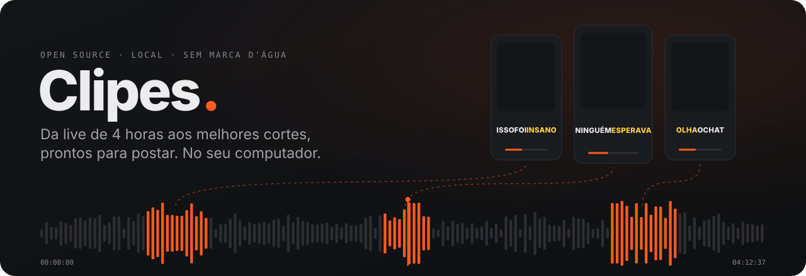
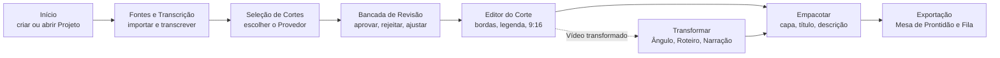
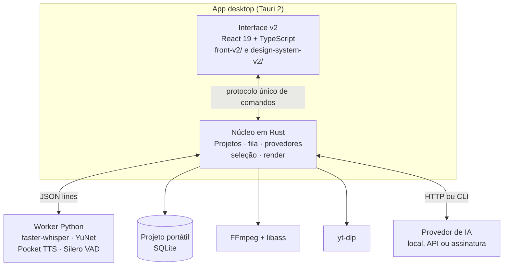

<!--
  RASCUNHO do README da v2.0.0 (ticket de #288, frente "README e lançamento").
  NÃO substitui o README.md da raiz: a v1.0.1 continua sendo a versão publicada.
  No lançamento da v2.0.0, copie este arquivo para a raiz, ajuste os links relativos
  (retire o prefixo ../../../) e resolva todos os TODO-LANÇAMENTO listados no fim.
  Os links relativos abaixo valem a partir de docs/produto/front-v2/.
-->

<div align="center">



<br>

**Transforme lives e vídeos longos em cortes verticais prontos para postar.**<br>
Transcrição local, IA que você escolhe, legenda karaokê e 9:16. Sem nuvem obrigatória, sem marca d'água, sem telemetria.

<br>

[](https://github.com/GUSTAVOHOOO/clipes/releases/latest)
[](https://github.com/GUSTAVOHOOO/clipes/actions/workflows/ci.yml)
[](../../../LICENSE)
[](#instalação-e-requisitos)
[](../../../CONTRIBUTING.md)

[**Baixar a v2.0.0**](https://github.com/GUSTAVOHOOO/clipes/releases/latest) <!-- TODO-LANÇAMENTO: link do release v2.0.0 (hoje /releases/latest aponta para a v1.0.1) --> ·
[Primeiro Corte](#do-primeiro-projeto-à-primeira-exportação) ·
[Local e Provedores](#processamento-local-e-provedores-opcionais) ·
[Ajuda](#ajuda) ·
[Arquitetura](#arquitetura) ·
[Contribuir](#contribuir) ·
[English](#in-english)

</div>

---

## Uma live de quatro horas, uma fila de Cortes prontos

Você entrega uma live longa. O Clipes transcreve o áudio no seu computador, aponta os momentos que valem um corte, explica a Nota de cada um e deixa você revisar tudo antes de exportar. O resultado são arquivos MP4 verticais (1080×1920) com legenda palavra por palavra, sem marca d'água.

<!-- TODO-LANÇAMENTO: vídeo 16:9 de demonstração (live real → Projeto → revisão → Corte exportado), sem edição que esconda tempo de processamento. Inserir aqui com <video> ou GIF. -->

> **Demonstração:** em breve, com uma live real do início ao fim.

**[Baixar o Clipes v2.0.0 →](https://github.com/GUSTAVOHOOO/clipes/releases/latest)** <!-- TODO-LANÇAMENTO: link do release v2.0.0 --> Instaladores para Windows e Linux. Dá para começar sem pagar nenhuma IA: veja [Processamento local](#processamento-local-e-provedores-opcionais).

> **A v2 troca a interface, não o núcleo.** A tela foi refeita do zero para ser mais enxuta e rápida de operar, e o núcleo em Rust, o formato do Projeto e os Provedores continuam os mesmos da [v1.0.0](../../releases/v1.0.0.md). **Projetos criados na v1 abrem na v2**: basta abrir a pasta `.clipes` em **Início**.

## O que é

O Clipes é um aplicativo de desktop gratuito e open source para quem vive de cortes. Ele transcreve a live na sua máquina, sugere os melhores trechos com uma Nota explicada por eixos, ajusta as bordas para não cortar ninguém no meio da frase, gera a legenda, enquadra em 9:16 e exporta.

Nenhuma etapa é caixa-preta. Você revisa antes de sair, e nenhuma chamada paga acontece sem você ver a estimativa de custo antes.

| | Ferramentas típicas na nuvem | Clipes |
|---|---|---|
| **Onde o vídeo fica** | Sobe inteiro para o servidor | Fica no seu PC. Só o texto da transcrição vai para a IA, e só se você usar uma IA remota |
| **Quem faz a IA** | O modelo do serviço | O Provedor que você escolher, inclusive um modelo local |
| **Custo** | Assinatura ou créditos por minuto | Grátis com modelo local. Com API paga, estimativa antes, valor real depois e teto por tarefa e por lote |
| **Nota do corte** | Um número sem explicação | Nota por eixos nomeados, com o motivo escrito |
| **Marca d'água** | Comum no plano grátis | Nunca |
| **Telemetria** | Normalmente ligada | Não existe. Relatos de problema só saem se você revisar e enviar |
| **Código** | Fechado | Apache-2.0 |

## Do primeiro Projeto à primeira exportação

Este guia segue as telas da v2 na ordem em que você as usa. Os nomes (Projeto, Fonte, Corte, Nota, Provedor e outros) são os do [glossário](../../../GLOSSARY.md). A barra superior mostra as três etapas do Projeto: **Fontes e Transcrição**, **Cortes** e **Exportação**. Você pode trocar de etapa a qualquer momento, e um trabalho longo continua rodando em segundo plano.



### 1. Início: crie ou abra um Projeto

Na primeira abertura, o **Assistente de primeiro uso** aparece sozinho em dois passos: (1) instala o FFmpeg e o Motor de transcrição local indicado para a sua placa de vídeo, memória e disco; (2) configura o Provedor de IA, se você quiser um. Dá para pular o segundo passo e voltar depois em **Configurações**. Os componentes de recursos específicos (`yt-dlp` para links, YuNet para o reenquadramento, Pocket TTS para a Narração) são baixados na hora em que você usa o recurso, com tamanho e licença à vista antes de confirmar.

Em **Início**, escolha:

- **Novo Projeto**: dê um nome e escolha a pasta onde salvar. Um Projeto é uma pasta `.clipes` portátil, com um banco SQLite. Use um por canal.
- **Abrir pasta `.clipes`**: abre um Projeto existente, **inclusive os criados na v1**. Os Projetos recentes ficam listados, e os que sumiram do disco aparecem como "Indisponível no disco" até você localizar a pasta.

> Quer só olhar a interface antes de instalar? Veja [Experimentar a interface sem instalar](#experimentar-a-interface-sem-instalar).

### 2. Fontes e Transcrição

Em **Fontes**, importe um arquivo do disco ou cole o link de um VOD. Para links, o app oferece baixar `yt-dlp` e `deno` na primeira vez. Cada Fonte guarda a **Permissão** do criador (quem autorizou, onde e para quê), que entra no crédito da descrição e nos avisos antes de exportar.

Abra a Fonte para transcrever. Você escolhe o **Motor de transcrição**:

- **Local** (padrão): `faster-whisper` na GPU NVIDIA ou na CPU, a US$ 0,00. A transcrição é feita em blocos com checkpoint, então fechar o app não perde o trabalho.
- **Groq** (opcional): transcrição remota. Só o áudio sai da máquina, com estimativa de custo e confirmação antes.

Depois da transcrição, o texto aparece frase por frase. Clique numa palavra (ou use **Ouvir aqui**) para tocar o trecho, `F2` corrige a grafia (sem mexer nos tempos) e `Ctrl+Z` desfaz. A busca (`Ctrl+F`) varre a Transcrição inteira. Para várias Fontes de uma vez, use a visão **Lotes**, com teto de custo opcional: uma Fonte com erro pausa sozinha e as outras seguem.

### 3. Seleção de Cortes: configure e dispare

Em **Cortes**, escolha a Fonte transcrita e configure a seleção: tipo de vídeo (**Corte direto** ou **Vídeo transformado**), faixa de duração e os sinais locais de energia do áudio e de replay do chat do YouTube. Antes de qualquer chamada ao Provedor, o app mostra um cartão com o Perfil de Provedor usado, se o texto sai da máquina e o custo estimado. A seleção roda por Janelas do tamanho certo para o contexto do modelo, e você acompanha o progresso por Janela.

### 4. Bancada de Revisão: aprove os candidatos

A **Bancada de Revisão** mostra a lista de candidatos à esquerda e, à direita, o preview 9:16 com a Nota e o motivo de cada eixo. Dá para decidir sem tirar a mão do teclado:

| Tecla | Ação |
|---|---|
| `A` / `R` | Aprovar / rejeitar o candidato |
| `I` / `O` | Recuar a borda inicial / avançar a borda final em uma Frase |
| `Ctrl+Z` | Desfazer a última decisão ou ajuste |
| `Enter` | Abrir o Corte no editor |

**Refazer com outro Perfil de Provedor** gera uma nova Revisão da execução sem perder as anteriores nem as decisões já tomadas.

### 5. Editor do Corte

Cada Corte aprovado abre na tela do Corte, com a barra de contexto no topo (`Alt+PageUp` e `Alt+PageDown` pulam entre os aprovados). O layout tem a **Transcrição do Corte** à esquerda (recolhível com `Ctrl+[`), o palco 9:16 no centro com o transporte e a timeline compacta embaixo.

A barra de cinco ações abre popovers sob demanda (`Ctrl+]` abre e fecha o último):

- **Enquadrar**: sugestão automática de rosto (YuNet, baixado quando você usa), cinco Layouts e crop manual com keyframes.
- **Legenda**: karaokê com texto e estilo editáveis por Corte e tradução PT-BR ↔ EN.
- **Silêncios**: remoção de silêncios, reversível.
- **Áudio**: trilha sonora, efeitos e a mixagem da Narração.
- **Histórico**: desfazer e instantâneos da edição.

As bordas sempre encaixam em Frase. Segurar `Alt` libera o ajuste por quadro, como exceção. O autosave grava a cada segundo, e o app confere o salvamento antes de você sair da tela ou fechar a janela. A Fonte original não é alterada.

### 6. Transformar (só para Vídeo transformado)

Se o Corte for um **Vídeo transformado**, a aba **Transformar** conduz três passos, com trava humana antes da Narração (veja o [ADR-0001](../../adr/0001-dois-tipos-de-video-e-regras-de-transformacao.md)):

1. **Ângulo**: escolha a perspectiva do comentário.
2. **Roteiro em blocos**: o Provedor sugere, você revisa e aprova. Só um Roteiro aprovado libera a Narração.
3. **Narração**: voz sintetizada localmente (Pocket TTS, baixado na primeira vez), gravação com teleprompter ou áudio importado, com limpeza de voz e revisão do alinhamento por palavra.

O **Corte direto** não passa por aqui: ele vai do editor direto para o Empacotamento.

### 7. Empacotar

<!-- TODO-LANÇAMENTO: confirmar #367 (sub-aba Empacotar ainda aberta na Onda 5) -->

A aba **Empacotar** prepara o que acompanha o vídeo na publicação: capa (escolha um quadro do preview e exporte em PNG), título, descrição com o crédito da Fonte (protegido contra edição), tags, hashtags e capítulos do YouTube. Validadores de tamanho avisam antes de você estourar um limite. O **Provedor** só sugere: tudo fica editável.

### 8. Exportação e Fila de Jobs

Há dois caminhos para exportar:

- **Um Corte**: `Ctrl+E` na tela do Corte. Um painel de conferência mostra Permissão, avisos de monetização e de glifos antes de renderizar.
- **Vários Cortes**: a **Mesa de Prontidão** (etapa **Exportação**) mostra todos os aprovados numa grade com título, capa e avisos. Dali você dispara um **lote** MP4 ou usa **Exportar só este** num cartão.

A exportação usa FFmpeg e libass, com paridade entre o preview e o arquivo final, loudness normalizado em duas passagens (-14 LUFS) e o encoder de hardware detectado (NVENC, QSV, AMF ou x264). Se o encoder de hardware cair para x264, o app avisa. O histórico de lotes fica na mesma tela.

A **Fila de Jobs** (`Ctrl+J`, de qualquer tela) reúne transcrições, seleções, downloads e exportações. Dali você cancela jobs, acompanha o progresso, pausa e retoma lotes e decide o que fazer com uma chamada paga que ficou incerta (ela nunca é repetida sozinha).

### 9. Relatos e Sobre

- **Relatos** (`#/relatos`): monta um relato de problema, ideia ou proposta de Provedor com um diagnóstico filtrado que você lê antes de enviar. Nada sai sozinho ([ADR-0006](../../adr/0006-relato-de-problemas-sem-telemetria.md)).
- **Sobre** (`#/sobre`): versão instalada, busca e instalação de atualizações assinadas, e as licenças.

### Atalhos que valem decorar

| Atalho | O que faz |
|---|---|
| `Ctrl+K` | Paleta de comandos |
| `Ctrl+J` | Fila de Jobs |
| `Ctrl+,` | Configurações |
| `F6` | Pula entre as regiões da janela |
| `?` ou `Ctrl+/` | Folha de atalhos |
| `Ctrl+E` | Exportar o Corte atual |

No macOS, que ainda não tem instalador, `Ctrl` vira `Cmd`. Em **Configurações → Aparência e teclado** você remapeia os atalhos e desliga as teclas de uma letra só (`A`, `R`, `I`, `O`...), se elas atrapalharem a digitação.

## Processamento local e Provedores opcionais

O Clipes funciona sem nenhuma conta e sem enviar o seu vídeo para lugar nenhum. Um **Provedor** (um modelo de linguagem) só entra nas Tarefas de IA, e você decide qual.

| Etapa | Onde roda | O que sai da máquina |
|---|---|---|
| Transcrição (padrão) | Local, `faster-whisper` na GPU ou CPU | Nada |
| Transcrição remota (Groq, opcional) | Servidor do Groq | Só o áudio, com estimativa e confirmação |
| Energia do áudio, detecção de rosto, VAD, Narração (Pocket TTS) | Local | Nada |
| Seleção de Cortes, Roteiro, Empacotamento, tradução de legenda | No Provedor que você escolher | Só o texto das Frases. Nunca o vídeo nem o áudio |
| Revisão, edição e exportação | Local, com FFmpeg e libass | Nada |

Tipos de Provedor:

| Tipo | Exemplos | Quanto custa | O que sai da máquina |
|---|---|---|---|
| **Modelo local** | Ollama, LM Studio ou outro servidor compatível com OpenAI | Nada | Nada |
| **API** | OpenAI, Anthropic, Gemini ou qualquer endpoint compatível com OpenAI | Por token. Estimativa antes, valor real depois | Só o texto das Frases |
| **CLI com a sua assinatura** *(experimental)* | Codex, Claude Code, OpenCode | Já incluído no plano que você paga | Só o texto das Frases |

Como o app protege você:

- **Aviso antes de qualquer ação externa.** Toda chamada a um Provedor remoto ou ao Groq mostra antes o Perfil usado, o destino, a estimativa em dólar ou o consumo de cota, e o teto restante. Você confirma, ou cancela.
- **Somente local.** Pode ser ligado por Tarefa ou para o Projeto inteiro. Ligado, nenhuma chamada remota acontece, nem para "refazer com outro Perfil". Um selo na barra superior mostra quando está ativo.
- **Orçamento.** Teto por chamada, por tarefa e por lote. Ao chegar nele, o app pausa e pergunta se você quer continuar.
- **Sem repetição às cegas.** Uma chamada paga com resultado incerto nunca é refeita sozinha: você decide, depois de ver a estimativa.
- **Trilha de auditoria** de cada chamada: modelo, tokens, custo e versão do prompt, sem o texto enviado (em **Configurações → Custos**).
- **Chaves no cofre do sistema** (Windows Credential Manager ou Secret Service no Linux), nunca em texto puro no Projeto.
- **Sem telemetria.** O app não envia nada sobre o seu uso.

Para trabalhar 100% local, aponte as Tarefas para um modelo local (Ollama ou LM Studio) e ligue **Somente local** em **Configurações → Projeto atual**. Veja o [ADR-0009](../../adr/0009-custo-orcamento-e-auditoria-de-chamadas-de-ia.md) e o [ADR-0010](../../adr/0010-perfis-multiplos-de-provedor-tarefa-para-perfil-e-somente-local.md).

## Instalação e requisitos

| Sistema | Pacote | Requisitos |
|---|---|---|
| **Windows 10 e 11** (x64) | Instalador `.exe` (NSIS), instala para o usuário atual sem pedir administrador | WebView2 (já vem no Windows 11). GPU NVIDIA é opcional |
| **Linux** (x64) | `.AppImage` ou `.deb` | GStreamer do sistema para o preview. O `.deb` já declara as dependências. GPU NVIDIA é opcional |
| **macOS** | Ainda não | Acompanhe em [#301](https://github.com/GUSTAVOHOOO/clipes/issues/301) |

Reserve espaço em disco para os Componentes, que são baixados na primeira vez em **Configurações → Componentes** (você vê tamanho e licença antes de confirmar, e cada arquivo é conferido por SHA-256). O modelo de transcrição tem cerca de 0,5 GB na CPU e 1,6 GB na GPU. Sem GPU NVIDIA, a transcrição roda na CPU com um modelo menor.

O app se atualiza sozinho, com pacotes assinados.

<details>
<summary><b>Windows: aviso do SmartScreen</b></summary>

<br>

<!-- TODO-LANÇAMENTO: confirmar se a assinatura de código no Windows já existe no lançamento (a issue #24 está fechada, mas o README da v1.0.1 ainda descreve o instalador como sem assinatura). Se já houver, remover este bloco. -->

Se o instalador ainda não tiver assinatura de código, o SmartScreen pode dizer que o aplicativo é desconhecido. Antes de executar, confira o arquivo com o `SHA256SUMS.txt` publicado na mesma release:

```powershell
Get-FileHash .\Clipes_2.0.0_x64-setup.exe -Algorithm SHA256
```

<!-- TODO-LANÇAMENTO: nome real do instalador da v2.0.0 (hoje, na v1.0.0, é Clipes_1.0.0_x64-setup.exe) -->

Se o hash bater, clique em **Mais informações** e depois em **Executar assim mesmo**.

</details>

<details>
<summary><b>Linux: AppImage e GStreamer</b></summary>

<br>

O preview usa o GStreamer do sistema. O `.deb` já instala o que precisa. O AppImage não embute GStreamer nem `libav` (veja o [ADR-0003](../../adr/0003-licenca-apache-ffmpeg-sob-demanda-e-politica-de-modelos.md)), então, no Debian ou Ubuntu, instale:

```sh
sudo apt install gstreamer1.0-plugins-good gstreamer1.0-plugins-bad gstreamer1.0-libav
```

</details>

## Ajuda

- **Dúvida de uso:** [Discussions](https://github.com/GUSTAVOHOOO/clipes/discussions).
- **Bug ou ideia:** [abra uma issue](https://github.com/GUSTAVOHOOO/clipes/issues/new/choose), ou use **Relatos** dentro do app, que monta um diagnóstico filtrado para você revisar e anexar.
- **Vulnerabilidade:** siga o [SECURITY.md](../../../SECURITY.md). Não abra issue pública.
- **Vocabulário e decisões:** [GLOSSARY.md](../../../GLOSSARY.md) e os [ADRs](../../adr/).

### Limitações conhecidas

- **Windows sem assinatura de código** (se ainda valer no lançamento): o SmartScreen pode avisar. Veja [acima](#instalação-e-requisitos).
- **macOS** ainda não tem instalador ([#301](https://github.com/GUSTAVOHOOO/clipes/issues/301)).
- **Linux AppImage** depende do GStreamer do sistema para o preview.
- **Converter um Corte direto em Vídeo transformado** aparece desabilitado na barra do Corte nesta versão. Escolha o tipo de vídeo antes de disparar a seleção. <!-- TODO-LANÇAMENTO: confirmar se o botão "Converter em Vídeo transformado" é ligado ao comando do núcleo (#292, fechado) antes do lançamento; se for, remover esta limitação. -->
- **Provedores via CLI** (Codex, Claude Code, OpenCode) seguem experimentais.
- **YouTube com restrição de idade:** o app detecta e orienta a baixar o vídeo e importar como arquivo local.
- **Idioma por Fonte:** a Transcrição fica no idioma em que foi dita. A tradução vale para a legenda do Corte (PT-BR ↔ EN).
- **Empacotamento 100% manual** (sem rodar o Provedor antes) ainda não é possível: a ficha nasce da sugestão ([#299](https://github.com/GUSTAVOHOOO/clipes/issues/299)). <!-- TODO-LANÇAMENTO: confirmar #299 -->

## Experimentar a interface sem instalar

Dá para abrir a interface da v2 no navegador, com um núcleo simulado e dados de exemplo. Serve para conhecer as telas, não para processar vídeo de verdade:

```sh
cd front-v2
bun install
bun run dev   # http://127.0.0.1:1430 (sobe com VITE_CORE_MOCK=1)
```

Para carregar o Projeto de demonstração, abra `http://127.0.0.1:1430/?source-test=1#/projeto/test-project/cortes`. Detalhes em [`front-v2/README.md`](../../../front-v2/README.md).

## Arquitetura



- **Núcleo em Rust**: toda a regra de negócio mora aqui. A interface só chama comandos, e por isso a v2 refez a interface inteira sem mudar o que o app faz.
- **Fila persistida**: transcrição, seleção e exportação são jobs no SQLite. O app fecha, abre de novo e continua de onde parou.
- **Worker Python isolado**: os modelos de ML rodam num processo separado, num ambiente do `uv` que o app instala sozinho. Ele não usa o Python do sistema.
- **Tarefas de IA como workflows fixos**: cada Tarefa tem prompt versionado e travado por hash, saída estruturada validada por schema e verificadores próprios. Trocar de Provedor não muda o resultado esperado.
- **Interface v2 em estados explícitos**: toda tela trata carregando, vazio, erro, parcial e em andamento, e mostra erros do núcleo como mensagens com ação, nunca como código cru.

| Camada | Tecnologia |
|---|---|
| Desktop | [Tauri 2](https://tauri.app/), que usa o WebView do sistema e gera instaladores pequenos |
| Interface | React 19, TypeScript, Vite, Bun, Base UI, Tailwind 4 e cores em OKLCH, sobre o [`design-system-v2/`](../../../design-system-v2/) |
| Núcleo | Rust e SQLite (rusqlite), com chaves no cofre do sistema (keyring) |
| ML | Python via `uv`: faster-whisper, YuNet, Silero VAD e Pocket TTS |
| Mídia | FFmpeg e libass, baixados sob demanda |
| Qualidade | GitHub Actions em Ubuntu e Windows, `cargo-deny`, testes de componente (Vitest) e de fluxo (Playwright) na interface, E2E com tauri-driver e WebdriverIO, DCO |

Cada decisão importante tem um registro com o contexto e o motivo:

| ADR | Decisão |
|---|---|
| [0001](../../adr/0001-dois-tipos-de-video-e-regras-de-transformacao.md) | Dois tipos de vídeo e as regras do Vídeo transformado |
| [0002](../../adr/0002-hyperframes-como-referencia-render-ffmpeg-libass.md) | Render com FFmpeg e libass |
| [0003](../../adr/0003-licenca-apache-ffmpeg-sob-demanda-e-politica-de-modelos.md) | Apache-2.0, FFmpeg sob demanda e política de modelos |
| [0004](../../adr/0004-stack-tauri-react-nucleo-rust-worker-python.md) | Tauri + React, núcleo Rust e worker Python |
| [0005](../../adr/0005-projeto-portatil-com-sqlite.md) | Projeto portátil com SQLite |
| [0006](../../adr/0006-relato-de-problemas-sem-telemetria.md) | Relato de problemas sem telemetria |
| [0007](../../adr/0007-tarefas-de-ia-como-workflows-fixos-no-nucleo.md) | Tarefas de IA como workflows fixos no núcleo |
| [0008](../../adr/0008-contrato-de-saida-estruturada-agnostico-de-provedor.md) | Saída estruturada independente de Provedor |
| [0009](../../adr/0009-custo-orcamento-e-auditoria-de-chamadas-de-ia.md) | Custo, orçamento e auditoria das chamadas de IA |
| [0010](../../adr/0010-perfis-multiplos-de-provedor-tarefa-para-perfil-e-somente-local.md) | Vários Perfis de Provedor e "Somente local" |

<details>
<summary><b>Mapa do repositório</b></summary>

<br>

| Pasta | Conteúdo |
|---|---|
| [`core/`](../../../core/) | Núcleo em Rust: comandos, Projetos, fila, Provedores, seleção, render |
| [`front-v2/`](../../../front-v2/) | Interface v2 (telas, rotas, Fila de Jobs, atalhos) |
| [`design-system-v2/`](../../../design-system-v2/) | Componentes e tokens visuais da v2 |
| [`src/`](../../../src/) e [`design-system/`](../../../design-system/) | Interface da v1, mantida como caminho de reversão <!-- TODO-LANÇAMENTO: confirmar #374 (a troca do Tauri para front-v2/ e o destino do front v1) --> |
| [`src-tauri/`](../../../src-tauri/) | Casca Tauri: janela, updater e empacotamento |
| [`worker/`](../../../worker/) | Worker Python de ML |
| [`catalog/`](../../../catalog/) | Catálogo assinado de modelos |
| [`benchmarks/`](../../../benchmarks/) | Dataset de VODs e benchmarks de transcrição e seleção |
| [`docs/adr/`](../../adr/) | Registros de decisão |
| [`docs/research/`](../../research/) | Pesquisas e experimentos, com os números |
| [`docs/produto/`](../../produto/) | Catálogo de funcionalidades do núcleo e a especificação da v2 |
| [`docs/contribuindo/`](../../contribuindo/) | Guias técnicos por área |

</details>

## Feito com medição

As decisões de modelo e de pipeline vêm de benchmarks reproduzíveis. Os relatórios ficam em [`docs/research/`](../../research/) e o código em [`benchmarks/`](../../../benchmarks/) e em `core/src/selection/`.

- **Transcrição**: modelos e precisões comparados em VODs reais em PT-BR e EN, inclusive bordas de palavra medidas contra alinhamento forçado (MFA).
- **Seleção de Cortes**: um harness compara a seleção com cortes feitos por humanos em lives reais. Ele decidiu o tamanho das Janelas (15 min com 3 min de sobreposição), descartou cascatas de modelo que não compensavam e mostrou que sinais sem IA (áudio, chat e texto) encontram uma parte relevante dos bons momentos.

## Roadmap

- [x] **v1.0**: núcleo completo, Corte direto e Vídeo transformado, instaladores para Windows e Linux
- [x] **v2.0**: interface refeita do zero, mais enxuta e rápida de operar, sobre o mesmo núcleo ([#288](https://github.com/GUSTAVOHOOO/clipes/issues/288)) <!-- TODO-LANÇAMENTO: marcar [x] só quando a v2.0.0 for publicada -->
- [ ] Seleção de Cortes guiada por sinais, com o Provedor só refinando os candidatos ([#319](https://github.com/GUSTAVOHOOO/clipes/issues/319))
- [ ] macOS ([#301](https://github.com/GUSTAVOHOOO/clipes/issues/301))
- [ ] Mais adiante: servidor MCP para agentes ([#192](https://github.com/GUSTAVOHOOO/clipes/issues/192)), clonagem de voz ([#214](https://github.com/GUSTAVOHOOO/clipes/issues/214)) e o resto de [melhorias futuras](../../futuro.md)

## Contribuir

Contribuições são bem-vindas, de correção de texto a Provedor novo.

```sh
git clone https://github.com/GUSTAVOHOOO/clipes.git
cd clipes
bun install
bun run tauri dev
```

Você precisa de Rust estável, [Bun](https://bun.sh/) e dos [pré-requisitos do Tauri](https://v2.tauri.app/start/prerequisites/) para o seu sistema.

<!-- TODO-LANÇAMENTO: confirmar #374. Hoje `bun run tauri dev` abre a interface da v1; a troca para front-v2/ é o ticket #374 (tauri.conf.json aponta para o front-v2). Os comandos abaixo valem depois da troca. -->

| Comando | O que faz |
|---|---|
| `bun run tauri dev` | Abre o app em modo de desenvolvimento |
| `cd front-v2 && bun run dev` | Só a interface v2 no navegador (`http://127.0.0.1:1430`), com o núcleo simulado |
| `cd front-v2 && bun run test` | Testes de unidade e de componente da interface (Vitest) |
| `cd front-v2 && bun run typecheck` | Checagem de tipos da interface |
| `cd front-v2 && bun run e2e` | Fluxos de ponta a ponta contra o mock, em 1366×768 e 1440×900 (Playwright) |
| `cargo test -p clipes-core` | Testes do núcleo |
| `bun run test:e2e` | Testes de ponta a ponta no app real ([guia](../../contribuindo/testes-e2e.md)) |

Antes do primeiro PR:

1. Leia o [guia de contribuição](../../../CONTRIBUTING.md). Todo commit leva `Signed-off-by` (`git commit -s`, [DCO](https://developercertificate.org/)).
2. Use o vocabulário do [glossário](../../../GLOSSARY.md). Fonte, Corte, Janela e Nota têm significado preciso aqui.
3. Para a interface, siga o [`DESIGN.md`](../../../DESIGN.md) e a [arquitetura da v2](./01-arquitetura.md).
4. Para estender o app, há guias de [Provedor](../../contribuindo/provedor.md), [Motor de transcrição](../../contribuindo/motor-de-transcricao.md), [Tarefa de IA](../../contribuindo/tarefa-de-ia.md) e [OpenCode](../../contribuindo/opencode.md).
5. Discorda de um ADR? Ótimo. Abra uma issue com a evidência. Os ADRs valem até um fato novo mostrar o contrário.

## Perguntas frequentes

<details>
<summary><b>Preciso de placa de vídeo?</b></summary>

<br>

Não. Sem GPU NVIDIA, o Clipes transcreve na CPU com um modelo menor, e por padrão agrupa os trechos de fala para ganhar velocidade. Com GPU NVIDIA, usa um modelo maior e mais preciso.

</details>

<details>
<summary><b>Meus Projetos da v1 funcionam na v2?</b></summary>

<br>

Sim. A v2 troca só a interface. O núcleo e o formato do Projeto (pasta `.clipes` com SQLite) são os mesmos, então os Projetos, Fontes, Transcrições, Cortes, edições e exportações da v1 abrem em **Início → Abrir pasta `.clipes`**. Se quiser uma garantia a mais, copie a pasta antes de abrir. O app também faz backup automático rotativo.

</details>

<details>
<summary><b>Dá para usar sem pagar nenhuma IA?</b></summary>

<br>

Sim. Aponte as Tarefas para um modelo local (Ollama ou LM Studio) e ligue **Somente local** no Projeto. Nada sai da máquina e nada é cobrado. Se você já paga uma assinatura com CLI (Codex, Claude Code ou OpenCode), também pode usá-la, ainda em caráter experimental.

</details>

<details>
<summary><b>O que exatamente vai para a IA?</b></summary>

<br>

Só o texto das Frases da transcrição, num formato compacto, nunca o vídeo nem o áudio. A única exceção é o motor de transcrição remoto (Groq), que envia o áudio, e só se você escolher esse motor e confirmar o custo.

</details>

<details>
<summary><b>Posso cortar a live de qualquer pessoa?</b></summary>

<br>

O Clipes registra a Permissão de cada Fonte: quem autorizou, onde e para quê. O crédito ao criador entra na descrição automaticamente, e o app avisa antes de exportar um Corte sem Permissão. A responsabilidade pelo uso continua sendo de quem publica.

</details>

<details>
<summary><b>Meu Projeto fica preso ao app?</b></summary>

<br>

Não. Um Projeto é uma pasta com um banco SQLite e as mídias. Copie a pasta para outro computador e abra. O app faz backup automático rotativo e restaura com verificação.

</details>

## Para mantenedores

<details>
<summary><b>Publicar uma release</b></summary>

<br>

1. Suba a versão em `package.json`, `src-tauri/tauri.conf.json`, `src-tauri/Cargo.toml` e `core/Cargo.toml` <!-- TODO-LANÇAMENTO: confirmar #377 (versão 2.0.0 nos manifestos, incluindo front-v2/package.json) -->, e atualize o [CHANGELOG](../../../CHANGELOG.md).
2. Crie a tag no commit a publicar, por exemplo `git tag v2.0.0` e `git push origin v2.0.0`.
3. O fluxo **Instaladores e release** gera o `.exe`, o `.AppImage` e o `.deb`, assina os pacotes do updater, publica o `SHA256SUMS.txt` e o `latest.json`.

Tags `catalog-N` publicam o catálogo de modelos assinado (Ed25519) por outro fluxo. A configuração das chaves do updater está no [guia de contribuição](../../../CONTRIBUTING.md#chave-do-updater).

</details>

## Licença e créditos

O Clipes é distribuído sob a [Apache-2.0](../../../LICENSE). Dependências e modelos seguem a política do [ADR-0003](../../adr/0003-licenca-apache-ffmpeg-sob-demanda-e-politica-de-modelos.md), e os avisos de terceiros estão em [`THIRD_PARTY_NOTICES.md`](../../../THIRD_PARTY_NOTICES.md).

Este projeto se apoia em trabalho aberto de muita gente: [Tauri](https://tauri.app/), [faster-whisper](https://github.com/SYSTRAN/faster-whisper), [FFmpeg](https://ffmpeg.org/), [libass](https://github.com/libass/libass), [yt-dlp](https://github.com/yt-dlp/yt-dlp), [Silero VAD](https://github.com/snakers4/silero-vad), [YuNet](https://github.com/opencv/opencv_zoo) e [Pocket TTS](https://github.com/kyutai-labs/pocket-tts).

---

## In English

**Clipes** is a free, open source desktop app that turns long livestreams and videos into vertical, captioned short clips. It runs on your own machine. Version 2 ships a new interface built from scratch on the same Rust core, and projects created with v1 open in v2.

- **Local first.** Transcription runs on your PC with faster-whisper, on an NVIDIA GPU or on the CPU. Your video never leaves the machine.
- **Bring your own AI.** Use a local model (Ollama, LM Studio), an API (OpenAI, Anthropic, Gemini, any OpenAI-compatible endpoint), or a CLI subscription you already pay for (Codex, Claude Code, OpenCode). A "local only" switch blocks remote calls per task or per project.
- **No surprises.** The app shows the estimated cost before each paid call and the real cost after, stops at your budget, and keeps an audit trail.
- **Explainable picks.** Every suggested clip comes with a score broken down by named criteria and a written reason.
- **Full editor.** Proxy preview, timeline, phrase-snapping trims, silence removal, karaoke captions, 9:16 reframing with face detection, FFmpeg + libass export with hardware encoders. No watermark, no telemetry.

Installers for Windows and Linux are on the [releases page](https://github.com/GUSTAVOHOOO/clipes/releases/latest). The project is written and documented in Brazilian Portuguese. Issues and PRs in English are welcome.

<div align="center">
<br>
<sub>Feito no Brasil, com código aberto, para quem corta live de madrugada.</sub>
</div>

---

## Pendências do lançamento (TODO-LANÇAMENTO)

Resolva todas antes de copiar este arquivo para a raiz. Cada marcador está no texto como comentário HTML `<!-- TODO-LANÇAMENTO: ... -->`.

1. **Vídeo 16:9 de demonstração** (live real, do Projeto à exportação), na abertura.
2. **Link do release v2.0.0** (botão de baixar no topo, na abertura e no bloco "In English"; hoje `/releases/latest` aponta para a v1.0.1).
3. **Nome real do instalador da v2.0.0** no comando `Get-FileHash` (hoje o exemplo usa `Clipes_2.0.0_x64-setup.exe`).
4. **Assinatura de código no Windows**: confirmar se existe no lançamento (a issue #24 está fechada, mas o README da v1.0.1 ainda diz que não há assinatura). Se existir, remover o bloco do SmartScreen e a limitação.
5. **Confirmar #367**: sub-aba Empacotar (Onda 5) ainda aberta; a seção "Empacotar" descreve o plano.
6. **Confirmar #299**: Empacotamento manual sem Provedor, citado nas limitações.
7. **Botão "Converter em Vídeo transformado"** (#292, fechado no núcleo): hoje aparece desabilitado na interface. Se for ligado, remover a limitação.
8. **Confirmar #374**: troca do Tauri para `front-v2/` e destino do front v1. O comando `bun run tauri dev` e o mapa do repositório dependem disso.
9. **Confirmar #377**: versão 2.0.0 nos manifestos (passo de release dos mantenedores).
10. **Marcar `[x]` no item "v2.0" do Roadmap** só quando a v2.0.0 for publicada.
11. **Confirmar #375 e #376** (E2E Tauri e CI migrados para as telas v2): afetam a linha `bun run test:e2e` da tabela de comandos.
