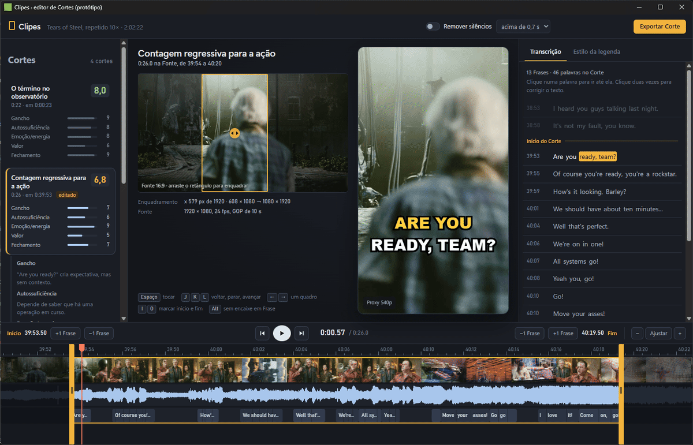

# Protótipo do editor de Cortes (v2)

Protótipo descartável do editor que a v1 do Clipes vai ter ([ticket #15](https://github.com/GUSTAVOHOOO/clipes/issues/15)). Serve para avaliar a experiência de edição e fechar a stack: Tauri 2 + WebView2 na UI, FFmpeg + libass no render. O código não é a base da v1.



## Como rodar

Pré-requisitos no Windows: Node, Rust stable com as ferramentas C++ do Visual Studio e FFmpeg com NVENC e libass no PATH (testado com o 8.1.1 do gyan.dev). Não há servidor à parte.

```powershell
cd prototypes/editor
npm install
npm run tauri dev
```

Na primeira vez, o `tauri dev` roda `npm run preparar` antes de abrir a janela. Esse passo leva uns 2 minutos e mais o download de 584 MB:

1. baixa o filme e a legenda oficial em inglês do mirror da Blender;
2. normaliza o filme para 1920×1080, 24 fps, H.264 com GOP fixo de 10 s e AAC. O GOP longo é proposital, para simular o pior caso de busca de um VOD;
3. concatena 10 cópias com `-c copy`, gerando `fonte-2h.mp4` (2:02:22);
4. gera `transcript.json` por palavra a partir do `.srt` (3.340 palavras e 870 Frases).

Nas execuções seguintes, a preparação só confere os arquivos (0,3 s). Tudo vai para `media/`, que fica fora do git, junto com `cache/` (proxies, miniaturas, onda) e `exports/`.

## O que cada parte da tela faz

| Área | O que faz |
|---|---|
| **Lista de Cortes** (esquerda) | Quatro Cortes de exemplo espalhados pela Fonte de 2 h (0:23, 39:53, 1:19:21 e 1:58:20). Cada um tem título, duração, posição e uma Nota de mentira com os eixos Gancho, Autossuficiência, Emoção/energia, Valor e Fechamento. O Corte ativo mostra as justificativas. Se você mexer nas bordas, no crop ou no texto, o Corte ganha a marca "editado". Setas ↑/↓ navegam pela lista. |
| **Fonte 16:9** (centro, à esquerda) | O quadro atual da Fonte, com o retângulo 9:16 do crop. Dá para arrastar com o mouse ou mover com ←/→ quando ele está focado (Shift move mais rápido). |
| **Preview 9:16** (centro) | O Corte enquadrado, com a legenda karaokê por cima. Enquanto você arrasta uma alça, aparece o quadro exato da borda e um aviso dizendo se ela encaixou numa Frase. No canto fica o estado da mídia: "Fonte direta · proxy 43%" enquanto o proxy é gerado, depois "Proxy 540p". |
| **Transcrição** (direita) | As Frases do Corte e duas de contexto antes e depois. Um clique numa palavra leva o preview até ela. Um duplo clique corrige o texto: Enter confirma, Esc cancela e texto vazio tira a palavra da legenda. A palavra atual fica em destaque. |
| **Estilo da legenda** (direita) | Quatro presets (Clássico, Impacto, Limpo, Documentário) e os controles de fonte, cor do texto, cor de destaque, contorno, tamanho, posição vertical, palavras por linha e maiúsculas. Muda o preview na hora e é o mesmo estilo que vai para o ASS. |
| **Timeline** (embaixo) | Régua, tira de miniaturas (sprite do FFmpeg), forma de onda (PCM analisado no Rust), faixa de Frases e palavras, playhead e silêncios removidos em listras. Clique ou arraste para fazer scrub, use a roda para rolar e Ctrl+roda ou os botões −/Ajustar/+ para o zoom. As alças âmbar encaixam na borda de Frase mais próxima; segure Alt para soltar o encaixe e mover quadro a quadro. |
| **Barra de transporte** | Tempo atual e duração, os botões **+1 Frase / −1 Frase** no início e no fim, e o zoom. |
| **Remover silêncios** (topo) | Liga a detecção de pausas acima do limite (0,4 s, 0,7 s ou 1,2 s), pelos vãos da Transcrição. As pausas aparecem na timeline, o play pula todas elas e o export também. Desligar volta ao Corte inteiro. |
| **Exportar Corte** (topo) | Gera o MP4 1080×1920 com crop, legenda ASS `\kf` pelo libass no estilo escolhido e os silêncios cortados. Usa NVENC e cai para x264 se ele falhar. Mostra a barra de progresso (`-progress pipe:1`) e abre a pasta com o arquivo selecionado. |

## Atalhos

| Tecla | Ação |
|---|---|
| Espaço | tocar e pausar |
| J / K / L | voltar (1×, 2×, 4× com toques repetidos), parar, avançar (1×, 2×, 4×) |
| ← / → | um quadro (1/24 s) |
| I / O | marcar início e fim no playhead, encaixando na Frase (com Alt, sem encaixe) |
| Alt + arrastar alça | borda livre, alinhada ao quadro |
| Ctrl + Shift + M | roda as medições de busca, scrub e arrasto e grava em `media/medicoes/` |

## Como funciona por dentro

- **Mídia pelo Tauri.** O protocolo próprio `midia://` (no Windows, `http://midia.localhost/…`) serve qualquer arquivo de `media/` com suporte a `Range` (respostas 206 de até 4 MiB) e CORS para o canvas. Ver `src-tauri/src/main.rs`.
- **FFmpeg pelo Rust**, com `std::process::Command`, sem shell e sem janela de console:
  - `gerar_proxy` faz uma única decodificação da janela do Corte (±2 min) e gera dois arquivos: o proxy 960×540 com GOP de 12 quadros (0,5 s), sem B-frames, e a tira de miniaturas (`fps=1/2,scale=192:108,tile`). O progresso vai para a UI por evento. Os arquivos são escritos como `.parcial` e renomeados no fim, então o cache só tem arquivos completos;
  - `gerar_onda` extrai PCM mono a 8 kHz e calcula 100 picos/s;
  - `exportar` aplica `crop`, `scale=1080:1920`, `ass=` e, com silêncios, `select`/`aselect` pelos trechos mantidos.
- **Um único `<video>`.** O preview 9:16 é o próprio vídeo deslocado por CSS, e a vista 16:9 é um canvas desenhado a cada quadro (`requestVideoFrameCallback`). Enquanto o proxy não fica pronto, o vídeo usa a Fonte direta. Quando ele fica pronto, a troca mantém o tempo.
- **Preview igual ao export.** A legenda do preview e o ASS saem do mesmo agrupamento (`legenda.js`). O karaokê em CSS imita o `\kf`, varrendo do destaque para a cor base. O tamanho da fonte foi calibrado contra o libass, que usa a altura de linha da fonte como `Fontsize` (Arial Black ×1,416, Impact ×1,231, Segoe UI ×1,333, Georgia ×1,153).
- **Frases.** Uma Frase termina em `.`, `!`, `?` ou `…`, ou numa pausa ≥ 700 ms. As palavras de cada legenda do `.srt` dividem a duração dela de forma proporcional ao tamanho.
- **Depuração.** Os `console.*` e erros do WebView aparecem no terminal do `tauri dev` com o prefixo `[ui:…]`. Se existir um `media/depurar.js`, o app executa o conteúdo dele sempre que o arquivo muda e registra o resultado no terminal. Foi assim que as medições e as verificações deste protótipo foram dirigidas.

## Atribuição

- **Tears of Steel**: (c) Blender Foundation | [mango.blender.org](https://mango.blender.org), licença [Creative Commons Attribution 3.0](https://creativecommons.org/licenses/by/3.0/). O filme e a legenda `TOS-en.srt` são baixados de <https://download.blender.org/demo/movies/ToS/> e ficam fora do repositório. Localmente, o filme foi cortado para 16:9, recodificado, concatenado 10× e transcrito por palavra a partir da legenda.
- **HyperFrames** (HeyGen, Apache-2.0, commit `5bf361f`): a regra de agrupamento de palavras em cartões de legenda veio da função `makeGroups` do componente `caption-pill-karaoke`, assim como o fim visível do grupo (`GROUP_END_BUFFER`) e o formato `{ text, start, end }` por palavra. O código está em `ui/js/legenda.js`, com o cabeçalho de origem e a marca "Modificado pelo Clipes". Nada de GSAP foi trazido e nenhum script do repositório deles foi executado. Detalhes em [THIRD_PARTY_NOTICES.md](THIRD_PARTY_NOTICES.md).

## Capturas

Todas são da janela real do app (WebView2), capturadas durante os testes:

| Tela | Arquivo |
|---|---|
| Lista de Cortes e Corte 2 aberto | [01-lista-de-cortes.png](screenshots/01-lista-de-cortes.png) |
| Edição com legenda e palavra corrigida | [02-edicao-com-legenda.png](screenshots/02-edicao-com-legenda.png) |
| Arrasto da alça de fim, com o botão do mouse ainda pressionado | [03-arrasto-de-alca.png](screenshots/03-arrasto-de-alca.png) |
| Painel de estilo (Impacto), crop deslocado e silêncios marcados | [04-painel-de-estilo-e-silencios.png](screenshots/04-painel-de-estilo-e-silencios.png) |
| Exportação concluída | [05-exportacao-concluida.png](screenshots/05-exportacao-concluida.png) |
| Proxy em geração (preview na Fonte direta) | [06-proxy-em-geracao.png](screenshots/06-proxy-em-geracao.png) |
| Três quadros de cada export | [07-export-1-quadros.png](screenshots/07-export-1-quadros.png), [08-export-2-quadros.png](screenshots/08-export-2-quadros.png) |

Medições e veredito da stack: [RESULTADOS.md](RESULTADOS.md).
