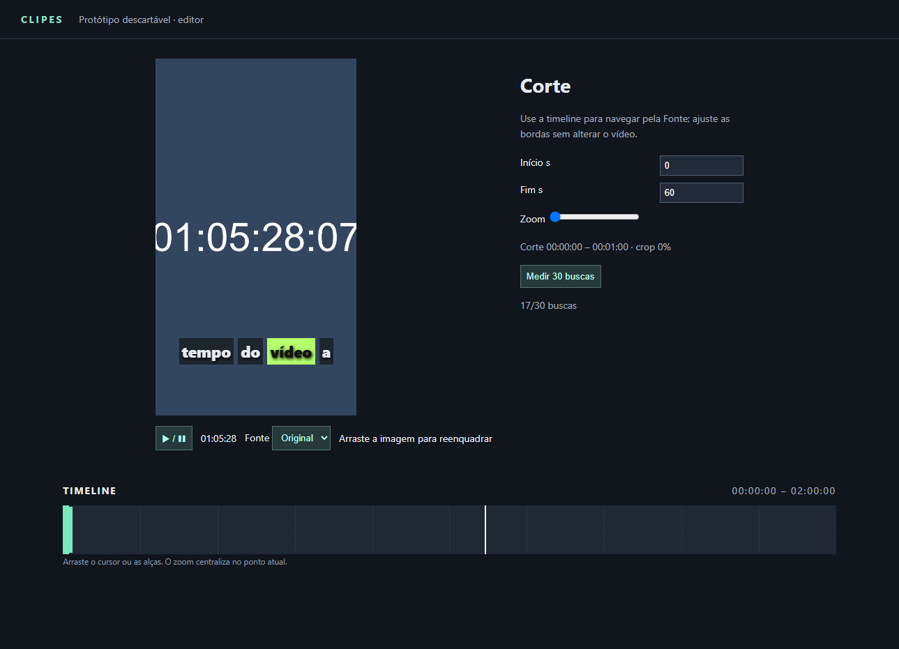

# Protótipo de editor — resultados parciais (12/11/2026)

**Veredito provisório:** Tauri 2 abre e apresenta a interface no WebView2; ainda não é possível aprová-lo para o editor. A amostra sintética sugere que FFmpeg + libass é rápido nesta máquina, mas não representa uma Fonte real. O proxy é uma opção a investigar, não uma exigência demonstrada; não há evidência de que Electron seja necessário. As medições com a janela visível e a interação humana, a deriva temporal e FPS de scrub/trim ainda precisam de validação antes de fechar o ticket.

## Como executar no Windows

Pré-requisitos: Node, Python, FFmpeg com NVENC/libass, Rust stable e ferramentas C++ do Visual Studio com Windows SDK. No PowerShell, a partir da raiz do repositório:

```powershell
cd prototypes/editor
./gerar-fonte.ps1  # cria Fonte de 2 h e transcrição; demora alguns minutos
./gerar-proxy.ps1  # proxy de 2 h para ensaio; também demora alguns minutos
node server.mjs    # manter este terminal aberto; servidor somente em 127.0.0.1
```

Em outro PowerShell:

```powershell
cd prototypes/editor/src-tauri
cargo run --release
```

A UI permite iniciar/reproduzir Corte, alterar início e fim em segundos ou nas alças, selecionar Fonte/proxy, mover o crop, ajustar zoom e fazer scrub. O botão de medição executa 30 buscas e baixa JSON; é experimental. Para regenerar os renders, rode `./render.ps1` em `prototypes/editor`. Os arquivos `media/` e binários `target/` ficam fora do git. O proxy gerado integralmente cobre 2 horas para comparação, não é a estratégia recomendada de custo para produção.

## Medições e limites

Máquina: Windows 11, RTX 3050 Laptop 4 GB, FFmpeg 8.1.1; WebView2 157.0.4341.46. Fonte sintética: 1920×1080, 30 fps, H.264 NVENC, GOP 300 quadros, AAC, relógio por quadro, duração 7.200 s, 167.740.024 bytes. Proxy: 640×360, GOP 30, 147.722.705 bytes. Conteúdo praticamente estático e bitrate reduzido: não é representativo de uma live real.

| Medição | Resultado | Limite |
|---|---:|---|
| Tauri release `.exe` | 8.626.176 bytes (~8,23 MiB) | sem instalador nem runtime WebView2 |
| Render NVENC 60 s | 12,44 s | crop 608×1080 central, escala 1080×1920, ASS `\kf`, áudio AAC, preset p4 |
| Render x264 60 s | 13,02 s | mesmo filtro, preset medium; não é comparação de qualidade igual |
| Pico RAM FFmpeg NVENC / x264 | 473,5 / 885,5 MiB | working set amostrado a cada ~0,5 s, processo FFmpeg apenas |
| Pico VRAM total NVENC / x264 | 921 / 718 MiB | GPU inteira via `nvidia-smi`, inclui outros processos; base observada 718 MiB |
| Busca no WebView2: Fonte | média 548,1 ms; p95 568,2 ms | 30 seeks programáticos; janela em segundo plano, callbacks limitados |
| Busca no WebView2: proxy | média 30,6 ms; p95 49,3 ms | 30 seeks programáticos; condições de foco/carga não controladas; não comparar diretamente |
| Sincronia no WebView2 com proxy | 0 divergências em 1.801 callbacks ao longo de 60 s | verifica índice da palavra no callback, não atraso de composição |
| Sincronia da legenda no Chromium | 0 divergências em 1.226 callbacks durante 60 s | amostragem só nos callbacks; não mede atraso de composição/visão nem prova fluidez |
| FPS durante scrub/trim e sensação | não medidos | avaliação interativa em WebView2 pendente |
| Deriva por palavra em 60 s | não medida de forma independente | necessário comparar vídeo e destaque efetivamente apresentados |

Os renders ocorreram em sequência, mas com compilação do Tauri em andamento; os valores são indicativos. Os MP4s resultantes têm H.264, AAC, 1080×1920 e 60 s, verificados com ffprobe. O uso de VRAM do x264 é a ocupação total da GPU, não atribuição ao processo. A Fonte sintética extremamente simples favorece ambos encoders.

A precisão é aferida pelo `mediaTime` do `requestVideoFrameCallback`, não por OCR do relógio: os 30 alvos amostrados têm a mesma fase fracionária e o frame anterior teve erro de -21 ms, dentro de um quadro de 33,3 ms; não é uma amostragem abrangente das fases. Na imagem do navegador, a busca próxima de 01:05:28 exibiu `01:05:28:07`, coerente com 3928,233 s para pedido 3928,254 s. O crop pode ocultar partes do relógio conforme o tamanho da janela. Para validar precisão e latência clique→pixels, registrar a tela com relógio visível completo e analisar os quadros de modo independente.



## Reprodução das medições

Os JSONs de buscas trazem pedido, `mediaTime`, latência até callback e user-agent. `buscas-original.json` e `buscas-proxy.json` são da aba Chromium do Orca e **não** são WebView2. A aba pode ser limitada em segundo plano; os números medem callback, não o instante físico do pixel, e devem ser refeitos em primeiro plano sob as mesmas condições. O botão inicia seeks programáticos, sem incluir a latência real do clique ou do arraste. Os arquivos `buscas-webview-fonte.json` e `buscas-webview-proxy.json` registram a coleta no app Tauri/WebView2. Os ~500 ms repetidos na Fonte sugerem callbacks limitados em segundo plano, enquanto a coleta do proxy ocorreu em outra execução; portanto não se pode concluir que o proxy causou a diferença. Repetir na mesma janela em primeiro plano, com carga controlada.

## HyperFrames e riscos de plataforma

Foi estudado o formato de lista normalizada `{text,start,end}`, o componente `caption-pill-karaoke`, os atributos de faixa e os métodos de seek/range do player no commit `5bf361f`; **nenhum código foi copiado**, nem GSAP foi usado. O controle HTML e a legenda são implementações próprias para o experimento.

Linux usa WebKitGTK; macOS usa WKWebView. Os codecs e a implementação de mídia dependem das versões e da plataforma, então resultados do WebView2 não generalizam. Precisam de testes próprios com formatos e seeking reais; não há testes nesses sistemas. Referências: [versões do WebView no Tauri](https://v2.tauri.app/reference/webview-versions/) e [pesquisa da stack](https://github.com/GUSTAVOHOOO/clipes/blob/research/stack/docs/research/stack.md).
